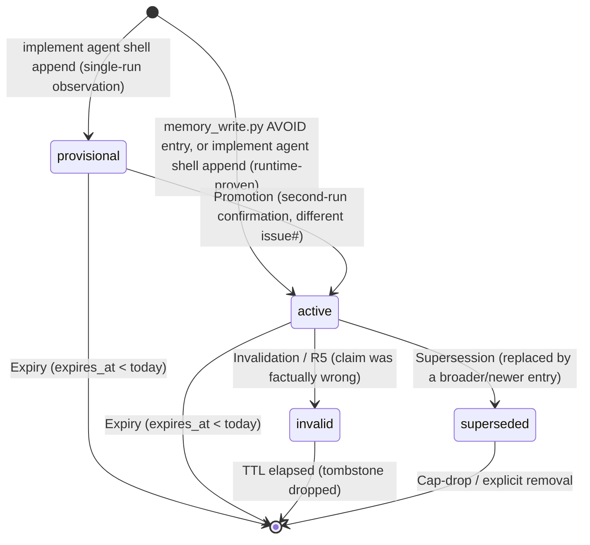

# Dark Factory Memory Contract

**Status:** active
**Maintainer:** dark-factory refinement pipeline
**Source issue:** #645 (epic #643)

This document is the stable contract between:

1. The flat-file format in `.archon/memory/*.md` (the current authoritative store)
2. The scripts that read and write it: `scripts/memory_retrieve.py` (reader, usually called
   through `scripts/load_memory_context.sh`), `scripts/memory_write.py` (gate writer, called
   through `gate_lib.sh::write_memory_entry()`), and `gate_lib.sh::route_memory_file()`
   (file routing)
3. A structured backend that would replace or sit beneath the flat files. A partial one exists
   (`index.jsonl` plus `records/`, built by `scripts/memory_import.py`) but is not the
   effective retrieval path in this repo; see
   [#486](https://github.com/omniscient/dark-factory/issues/486)

All pipeline phases, prompts, and gates must conform to this contract. When a prompt
and this document diverge, update the prompt.

---

## 1. Schema Field Table

Fields the future structured backend must support. The "Flat-file representation" column
maps each field to its current `.archon/memory/*.md` encoding.

| Field | Type | Flat-file representation |
|---|---|---|
| `id` | string (UUID/slug) | *(none — positional; use `file:line` as surrogate)* |
| `type` | enum: `pattern`, `avoidance`, `fix` | `[PATTERN]`, `[AVOID]`, `[FIX]` tag prefix |
| `status` | enum: `active`, `provisional`, `invalid`, `superseded` | `[PROVISIONAL]` or `[INVALID: reason]` prefix; `active` is the implicit default |
| `confidence` | float 0–1 | Derived by `memory_import.py`: `[INVALID]` → 0.0; `[PROVISIONAL]` → 0.4; otherwise by `source:` — `implement`/`conformance` → 1.0, `refine`/`code-review`/`bootstrap`/unknown → 0.7 |
| `source` | enum: `bootstrap`, `refine`, `implement`, `conformance`, `code-review` | `source:` inline comment token |
| `created_at` | ISO-8601 date | `date:YYYY-MM-DD` inline comment token |
| `updated_at` | ISO-8601 date | *(none — the only in-place update is reinforcement: when `memory_write.py` is given a lesson whose normalized text matches an existing entry, it rewrites that entry's `date:` and `expires:` instead of adding a duplicate, so `date:` is "last reinforced", not strictly "created")* |
| `expires_at` | ISO-8601 date | `expires:YYYY-MM-DD` inline comment token |
| `supersedes` | string (id of replaced entry) | *(implicit — cap-drop in favour of a newer entry; no explicit `supersedes` tag. `memory_maintain.py` dedup currently retags the older near-duplicate as `[INVALID: superseded by identical entry added <date>]`, which conflicts with §2; see [#486](https://github.com/omniscient/dark-factory/issues/486))* |
| `project` | string | *(none in flat-file; `index.jsonl` rows older than #486 carry one, but `memory_write.py` no longer writes the index)* |
| `agent_id` | string | `agent:` inline comment token on entries written by `memory_write.py`, which sets it to the same value as `source:`. The former role constants (`scripts/agent_roles.sh`) were removed as dead code in [#491](https://github.com/omniscient/dark-factory/issues/491); tagging and filtering use `source:` only |
| `phase` | enum: `refine`, `implement`, `conformance`, `code-review` | Overlaps with `source:` |
| `issue_number` | int | `issue:#N` inline comment token |
| `pr_number` | int | *(none — not tracked in flat-file)* |
| `files` | string[] | `path:file/prefix` inline comment token |
| `concepts` | string[] | *(none — free-text tagging not yet in flat-file; future-only)* |
| `content` | string | Text body of the entry after the `[TAG]` prefix |
| `rationale` | string | `**Why:**` line in the entry body (for feedback-type entries) |

---

## 2. Tag and Lifecycle State Mapping

### Entry types and status values

| Flat-file tag | Structured `type` | Structured `status` | Meaning |
|---|---|---|---|
| `[PATTERN]` | `pattern` | `active` | Observed, validated approach — use it |
| `[AVOID]` | `avoidance` | `active` | Confirmed anti-pattern — never do this |
| `[FIX]` | `fix` | `active` | Specific corrective action for a known class of bug |
| `[PROVISIONAL]` (in provisional section) | *(any)* | `provisional` | Single-run observation; unvalidated |
| `[INVALID: reason]` | *(original type)* | `invalid` | Claim was factually wrong; tombstoned |
| *(implied by dedup/cap-drop)* | *(original type)* | `superseded` | Claim was once correct; replaced by a broader/newer entry |

### Lifecycle transitions (four distinct paths — must not be conflated)

**1. Expiry** — `active` or `provisional` → auto-dropped when `expires_at < today`.
Implemented in three places: `memory_write.py` strips expired authoritative entries from the
target file before every write; `memory_maintain.py run` expires authoritative and provisional
entries; and the implement command (`commands/dark-factory-implement.md`) has the agent run an
awk expiry block before it appends.

**2. Invalidation (R5)** — `active` → `status=invalid`. The entry text is rewritten from
`[PATTERN]` to `[INVALID: reason]`. Used when the claim is **factually wrong**.
The tombstone stays during its TTL to prevent re-addition of the same wrong claim.
Does **not** imply there is a replacement entry.

**3. Supersession** — `active` → `status=superseded`. The newer entry (B) has broader or
more accurate scope; entry A was once correct but is now outdated. In the flat-file,
supersession is expressed **implicitly**: B is appended, A is removed by the R4 cap-drop
(with a `scope covered by newer entry` comment) or R3 dedup. In the structured backend, B
carries `supersedes: A.id` and A transitions to `status=superseded`.
**Supersession is not invalidation** — A was never wrong; it is merely outdated. Conflating
the two destroys the "was this ever right?" signal agents use when weighting historical context.
Known deviation: `memory_maintain.py run` dedup (similarity ≥ 0.90) retags the older entry as
`[INVALID: superseded by identical entry added <date>]`, which is exactly this conflation.
Tracked in [#486](https://github.com/omniscient/dark-factory/issues/486).

**4. Promotion** — `provisional` → `active`. A `[PROVISIONAL]` entry is promoted to
`[PATTERN]` when confirmed by a *different* issue number in a later pipeline run.
Implemented by the implement agent's cross-run confirmation check.

---

## 3. Write Bar

An entry may only become durable memory if it passes this bar:

> **"Would a future agent make a materially different architectural decision because of
> this entry, compared to reading `CLAUDE.md` and `ARCHITECTURE.md` alone?"**
>
> If no → skip.

### Per-phase thresholds

| Phase | When to write | What to write |
|---|---|---|
| **Refine** | Only when a trade-off between two approaches was explicitly weighed in Phase 4 Q&A, or a codebase convention absent from `CLAUDE.md` and `ARCHITECTURE.md` was found during context assembly. Most refine runs add zero entries. | Architectural decisions to `architecture.md`; conventions to the matching area file. Never `codebase-patterns.md`. Written through `memory_write.py`, so every refine entry is tagged `[AVOID]` (see scoping matrix). |
| **Implement** | Only when a pattern is runtime-proven in the delivered code. Single-run observations that cannot be verified via code go to `[PROVISIONAL]` first. | Area-specific patterns (backend, frontend, dark-factory-ops, codebase). Promoted from `[PROVISIONAL]` only when a different issue confirms them. |
| **Conformance** | Only when a MATERIAL violation was found **and** successfully remediated in the same run (`CONFORMANCE_CYCLE > 0`). | `[AVOID]` entries in the area file matching the violation. |
| **Code-review** | Only when `STATUS=BLOCKED` (confirmed blocking findings that were acted on). | `[AVOID]` entries in the area file matching the finding. |

### Always prohibited

- Entries that duplicate content already in `CLAUDE.md` or `ARCHITECTURE.md`
- Ephemeral task details or current-conversation context
- Debug solutions already visible in the committed code
- Git history summaries (authorship, what changed)

---

## 4. Scoping Rules: Writer-Role × Memory-File Matrix

### Authorised writers per file

| Memory file | Authorised writers | Trigger condition |
|---|---|---|
| `architecture.md` | **refine only**; bootstrap (seed) | Trade-off explicitly weighed in Phase 4 Q&A |
| `backend-patterns.md` | implement, conformance, code-review; refine (conventions) | Runtime-proven pattern / material AVOID finding in backend code |
| `frontend-patterns.md` | implement, conformance, code-review; refine (conventions) | Runtime-proven pattern / material AVOID finding in frontend code |
| `dark-factory-ops.md` | implement, conformance, code-review; refine (conventions) | Runtime-proven pattern / material AVOID finding in factory scripts/config |
| `codebase-patterns.md` | implement, conformance, code-review — **refine is forbidden** | Runtime-proven cross-cutting lessons only |

Which files exist depends on the target. This repo's store holds `architecture.md`,
`codebase-patterns.md` and `dark-factory-ops.md`; `backend-patterns.md` and
`frontend-patterns.md` are listed by the scripts but absent here.

### How each role writes

| Role | Mechanism | Tags it can produce |
|---|---|---|
| Refine | `memory_write.py`, called directly from the command | `[AVOID]` only |
| Conformance, code-review | `gate_lib.sh::write_memory_entry()` → `memory_write.py` | `[AVOID]` only |
| Implement | Shell appends by the agent, following `commands/dark-factory-implement.md` | `[PATTERN]`, `[AVOID]`, `[FIX]`, `[PROVISIONAL]`, and `[INVALID: reason]` rewrites |

`memory_write.py` always writes `- [AVOID] …`; it never writes `[PATTERN]`, `[FIX]` or
`[PROVISIONAL]`. Refine therefore records both the chosen and the rejected approach as
`[AVOID]` entries, which the refine command documents as a known tool limitation.

### Readers and read-only roles

| Phase | Reads memory | How |
|---|---|---|
| Refine, plan, implement | yes | `scripts/load_memory_context.sh <phase>` → `memory_retrieve.py` |
| Validate | yes | `memory_retrieve.py --phase validate`, called directly |
| Conformance, code-review | no | They write only |
| Revise-advisory | no | Neither reads nor writes |

**Plan and validate** are read-only consumers: they load memory but never write it.

### Bootstrap provenance

The `bootstrap` source tag marks entries written before the pipeline ran (one-time seed origin).
It is not a recurring role; no command file exists for it.

### Scoping primitives (inline comment tokens)

All are written as `<!-- token:value -->` comment at the end of the entry line:

| Token | Meaning |
|---|---|
| `source:<role>` | Identifies the writer role (provenance). Always required. |
| `path:<prefix>` | Area scoping. Entries with `path:` are filtered at load time against `AFFECTED` (files changed on the branch). Entries without `path:` are always included (backward-compatible default). |
| `issue:#N` | Ties the entry to its originating issue for audit and expiry TTL tracking. |
| `date:YYYY-MM-DD` | Write date. Always required. |
| `expires:YYYY-MM-DD` | Absolute expiry. Typical TTL is 6 months from `date:`. |
| `agent:<role>` | Written by `memory_write.py`; currently always equal to `source:`. |
| `scope:<scope>` | Written by `memory_write.py`; derived from the target file name. |
| `evidence:<method>` | On `[PROVISIONAL]` entries: how the behaviour was observed (`docker-exec`, `test-output`, …). A second `evidence:` from a different issue is the promotion signal. |
| `promote_as:<TAG>` | Optional, on `[PROVISIONAL]` entries: the tag `memory_maintain.py` gives the entry on promotion (default `PATTERN`). |

### Quota limits

| Quota | Limit | Enforcement |
|---|---|---|
| Authoritative entries per file (`[PATTERN]` + `[AVOID]` + `[FIX]`) | Cap 30 (R4) | Two different behaviours. `memory_write.py` (refine, conformance, code-review) **skips the new entry** when the file already holds 30 and drops nothing. The implement agent is instructed by its command to drop the oldest/lowest-signal entries before committing when the count exceeds 30. |
| Provisional entries per file | Cap 10 | Instruction to the implement agent only; no script enforces it. |

The cap is not hard-enforced: as of 2026-11-16 this repo's three memory files hold 31, 31 and
34 authoritative entries. Tracked in
[#486](https://github.com/omniscient/dark-factory/issues/486).

Where the implement agent does drop an entry under the cap, that is the flat-file
implementation of supersession: the older entry is `status=superseded` even though no explicit
tag is added. The drop comment `scope covered by newer entry` records the reason.

---

## 5. Backwards Compatibility

The `.archon/memory/*.md` flat-file format is the **authoritative read/write interface** until
a structured backend is formally adopted. Migrating storage before establishing equivalence would
silently break the pipeline.

### Stable guarantees

The following are format invariants. No pipeline change may alter them without a breaking-change
notice and migration plan:

- **Tag prefixes** (`[PATTERN]`, `[AVOID]`, `[FIX]`, `[PROVISIONAL]`, `[INVALID]`) are stable — no renames.
- **Inline comment tokens** (`source:`, `date:`, `expires:`, `issue:`, `path:`) are stable — the flat-file is the source of truth for any migration field mapping. The other tokens in §4 (`agent:`, `scope:`, `evidence:`, `promote_as:`) are in use but not yet part of this guarantee.
- **Section delimiter** — the `---` line separating the authoritative section from the provisional section is a format invariant; tooling must not delete it.
- **Any structured backend** must be able to ingest all entries in the current `.archon/memory/*.md` files without data loss.

### Migration path (when a structured backend is adopted)

1. Define a migration mapping from every inline comment token to the corresponding schema field (see §1).
2. Run a migration script that reads each `.archon/memory/*.md` file and inserts rows into the structured store.
3. Validate that the structured store produces identical `memory_retrieve.py` output for a representative `AFFECTED` file set.
4. Update `memory_retrieve.py` and `memory_write.py` to use the structured backend.
5. Update this document's status to `migrated` and point to the new backend's schema doc.

---

See also: [Dark Factory Memory v2 — Rollout & Fallback](dark-factory-memory-v2.md) for the operator runbook (rollout status, fallback behaviour, rollback steps, maintenance CLI, cost/perf, and security).
