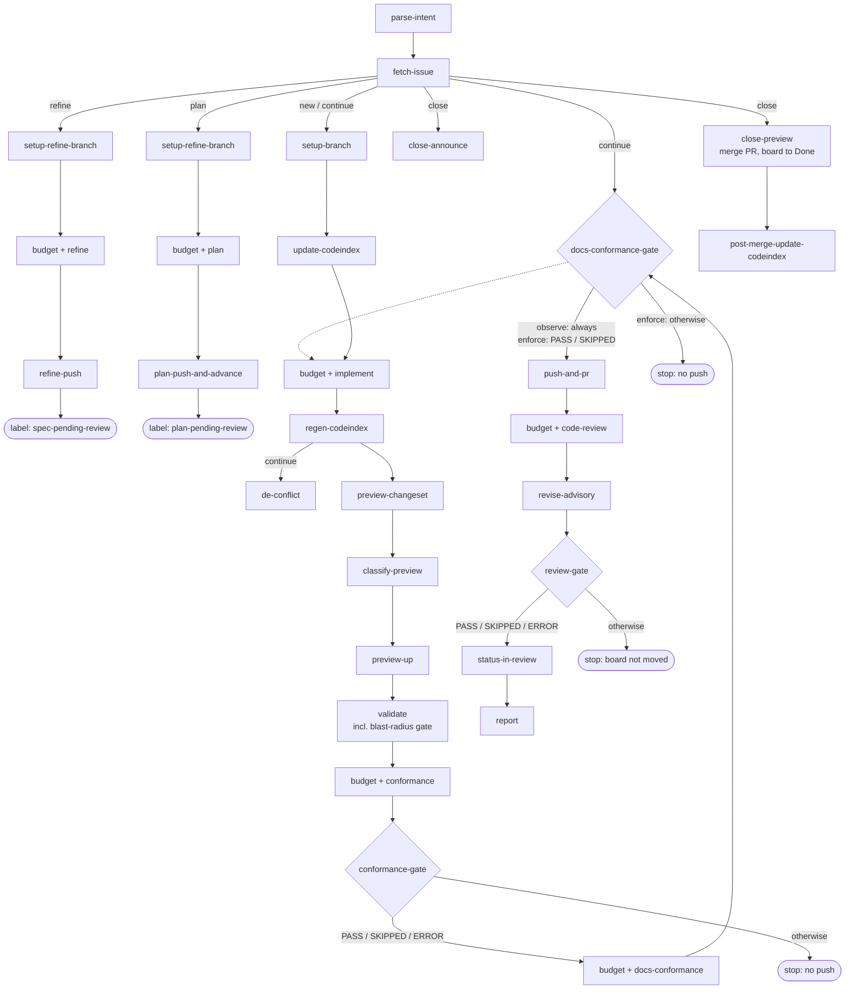

# Run lifecycle

What one factory run does, from container start to container exit.

A **run** is one container started from the factory image with a single command string
such as `Fix issue #42`. The image's entrypoint is `entrypoint.sh` (`Dockerfile:137,175`).
The entrypoint prepares a clone of the target repository, runs some checks, and then
either handles the command itself or hands it to the Archon workflow
`workflows/archon-dark-factory.yaml`, a DAG of 44 nodes. When the workflow returns, the
entrypoint writes the run record and posts a cost report.

This document is drafted from the code on `main`. It was first written against commit
`254c9d2` and revised against `64cd44a` for three later changes: per-scenario context
budget files ([PR #519](https://github.com/omniscient/dark-factory/pull/519)), the
epic-autopilot adapter lookup ([PR #524](https://github.com/omniscient/dark-factory/pull/524)),
and the move of issue-comment posting onto the provider CLI
([PR #525](https://github.com/omniscient/dark-factory/pull/525)). Statements carry
`path:line` references so they can be checked. Where the code is unclear or looks wrong,
the point is listed under [Open questions and oddities](#open-questions-and-oddities)
instead of being explained away.

Related documents (not repeated here):

| Topic | Document |
|---|---|
| Which run is started, and when (polling, priorities, WIP, retries, breaker) | [scheduler.md](scheduler.md) |
| Config keys and their values | [configuration.md](configuration.md) |
| Memory files, retrieval and write rules | [dark-factory-memory-v2.md](dark-factory-memory-v2.md) |
| Token budgets and the optimizers | [dark-factory-token-optimization.md](dark-factory-token-optimization.md) |
| Adapters and hooks | [adapter-authoring-guide.md](adapter-authoring-guide.md) |
| Labels | [triage-labels.md](triage-labels.md) |
| Terms | [domain.md](domain.md) |

## Contents

1. [Intents](#1-intents)
2. [Before the workflow: `entrypoint.sh`](#2-before-the-workflow-entrypointsh)
3. [Paths handled entirely by the entrypoint](#3-paths-handled-entirely-by-the-entrypoint)
4. [The workflow DAG](#4-the-workflow-dag)
5. [The phase commands](#5-the-phase-commands)
6. [Gates](#6-gates)
7. [After the workflow](#7-after-the-workflow)
8. [The artifacts directory](#8-the-artifacts-directory)
9. [How a run ends](#9-how-a-run-ends)
10. [Open questions and oddities](#open-questions-and-oddities)

---

## 1. Intents

The scheduler starts a run with
`docker compose -f /opt/dark-factory/docker-compose.yml --profile factory run -d --rm dark-factory "<command>"`
(`scheduler.sh:370-388`; the compose file is `run-compose.yml`, baked to that path by
`Dockerfile:150`). The command string is the only argument. A human can start the same
run by hand; with no argument the entrypoint prints usage and exits 1
(`entrypoint.sh:120-129`).

The command is interpreted twice, by two different mechanisms:

1. **Entrypoint intent.** `entrypoint.sh:134-139` takes the first `#<digits>` as the issue
   number and matches the first word, case-insensitively, against
   `fix|continue|close|refine|plan|deconflict|recheck`. No match means `fix`. The exact
   strings `Fix main` / `fix main` become `fix-main`.
2. **Workflow intent.** If the run reaches the workflow, the `parse-intent` node (a Haiku
   prompt with no tools) re-parses the same string into
   `new|continue|close|refine|plan|resolve` (`workflows/archon-dark-factory.yaml:21-41`).
   `fetch-issue` stores that value as `.intent` in `issue.json` (`:120-124`), which is
   what the phase commands read.

| Command the scheduler passes | Entrypoint intent | Workflow intent | Where the work happens |
|---|---|---|---|
| `Refine issue #N` (`scheduler.sh:269,1377`) | `refine` | `refine` | Workflow: refine phase |
| `Plan issue #N` (`scheduler.sh:305,1310`) | `plan` | `plan` | Workflow: plan phase |
| `Fix issue #N` (`scheduler.sh:1190,1246`) | `fix` | `new` | Workflow: implement through report |
| `Continue issue #N` (`scheduler.sh:351,1136,1242`) | `continue` | `continue` | Workflow: same path as `new`, on the existing branch, with feedback digest and a merge of `main` |
| `Close issue #N` (`scheduler.sh:343,1130`) | `close` | `close` | Workflow: merge PR, tear down preview, refresh hotspots |
| `Deconflict issue #N` (`scheduler.sh:1100`) | `deconflict` | never reached | Entrypoint only ([section 3](#3-paths-handled-entirely-by-the-entrypoint)) |
| `Recheck main` (`scheduler.sh:216`) | `recheck` | never reached | Entrypoint only: smoke gate, then exit |
| `Fix main` (`scheduler.sh:242`) | `fix-main` | never reached | Entrypoint only: main-red auto-fix |

When and why the scheduler picks each command is covered in [scheduler.md](scheduler.md).

The workflow's `resolve` intent has no command that reaches it today; see
[oddity 1](#open-questions-and-oddities).

### The container

`run-compose.yml` defines the `dark-factory` service the run executes in:

- Environment comes from `.archon/.env` (required, `run-compose.yml:23-25`) plus explicit
  identity variables (`FACTORY_OWNER`, `FACTORY_REPO`, the project board field and status
  option ids, `FACTORY_PRODUCT_NAME`, `FACTORY_CLONE_DIR`, `FACTORY_RUN_PREFIX`; `:31-47`).
- Model aliases used by the workflow and commands (`opus`, `sonnet`, `haiku`, `fable`)
  are pinned to model ids by `ANTHROPIC_DEFAULT_*_MODEL` (`:50-53`).
- `/var/lib/dark-factory` is a named volume shared with the scheduler (`:59`, `:112-114`).
  The run writes state there that the scheduler reads back: the main-red sentinel, the
  session-window pause sentinel, error-signature files, `runs.jsonl`, `current-run.json`,
  `hook-warnings.log`.
- `BUILDKIT_HOST` / `BUILDKIT_PORT` name the build daemon the preview step uses (`:56-57`).
- An optional `factory-model-proxy` service exists under its own profile (`:76-91`); see
  [dark-factory-model-proxy-rollout.md](dark-factory-model-proxy-rollout.md).

---

## 2. Before the workflow: `entrypoint.sh`

The script runs under `set -euo pipefail` (`entrypoint.sh:2`). Steps, in execution order:

| # | Step | Lines | Notes |
|---|---|---|---|
| 1 | Source instance identity (`scripts/identity.sh`) | 5-6 | Provides repo slug, clone dir, board constants |
| 2 | Provider preflight (`providers/cli.py preflight`) | 9-10 | Validates required environment. A failure here ends the run before any ticket signal exists |
| 3 | Git identity (`<Product> Factory`, `factory@<repo>`) | 20-25 | |
| 4 | Parse arguments into `ISSUE_NUM` and `INTENT` | 120-139 | See [section 1](#1-intents) |
| 5 | Generate `RUN_ID` (uuid4 hex), record `RUN_STARTED_AT`, create `ARTIFACTS_DIR` | 143-147 | `~/.archon/workspaces/<owner>/<repo>/artifacts/runs/<run-id>` |
| 6 | Ledger-writability check on `runs.jsonl` | 153-171 | Warning plus a health event; never fatal |
| 7 | Write `current-run.json` to the state dir | 185-193 | Read by the model proxy. `stage` is the intent for single-phase intents and `unknown` for `fix`/`continue` |
| 8 | Concurrency guard | 200-210 | Counts other running containers whose name contains `FACTORY_RUN_PREFIX`; exits 1 if that count is at or above `FACTORY_WIP_LIMIT` |
| 9 | Move the issue to **In Progress** | 224-227 | Skipped for `close`, `refine`, `plan`, `deconflict`, and when there is no issue number |
| 10 | Install the `ERR` trap `on_failure` | 666 | From here on, an unguarded failing command runs `on_failure` ([section 9](#9-how-a-run-ends)) |
| 11 | `gh auth setup-git` | 789 | Credentials come from the `gh` helper, not the remote URL (reason at `:13-17`) |
| 12 | Delete any existing clone dir, `git clone`, `cd` into it | 792-797 | |
| 13 | Adapter validity gate | 800 | [Gate A2](#a-run-start-gates-entrypoint) |
| 14 | Self-contained fallbacks | 811-828 | If the clone lacks `dark-factory/scripts`, `.archon/workflows` or `.archon/commands`, copy the baked copies in and add them to `.git/info/exclude` |
| 15 | Materialize the effective config | 834-835 | `factory_core.effective_config --materialize`; fail-open |
| 16 | Apply config knobs | 838 (`_entrypoint_cfg_apply`, 45-74) | Reads `scheduler.factory_wip_limit`, `conflict_resolution.ai_tier` and the three `scheduler.session_window_*` keys from `.claude/skills/refinement/config.yaml` in the clone, else `/opt/refinement-skills/config.yaml` |
| 17 | Compute the side-effect level, prepend the git/gh shim dir to `PATH` | 841 (`_compute_side_effect_level`, 92-117) | Reads only the baked config. Falls back to level 1 if resolution fails |
| 18 | Copy the preview compose template and `seed/` into `dark-factory/` in the clone; git-exclude both | 846-853 | |
| 19 | Install target dependencies | 858-872 | `pip install -r backend/requirements.txt` and `npm install` in `frontend/`, each only if the file exists |
| 20 | Write `.claude/settings.local.json` (Workflow tool disabled; codeindex MCP server if the binary exists); git-exclude it | 881-891 | |
| 21 | `pre-commit install` | 894 | Failure ignored |
| 22 | `fix-main` branch | 896-904 | Runs and exits; [section 3](#3-paths-handled-entirely-by-the-entrypoint) |
| 23 | Smoke gate, for `fix`, `continue`, `deconflict`, `recheck` | 910-913 | [Gate A3](#a-run-start-gates-entrypoint) |
| 24 | `recheck` exit | 919-922 | Reaching this line means the gate passed |
| 25 | `deconflict` flow | 928-1024 | Runs and exits; [section 3](#3-paths-handled-entirely-by-the-entrypoint) |
| 26 | Run the workflow | 1027-1086 | `archon workflow run archon-dark-factory "$ARGUMENTS"`, output tee'd to a temp file |

The workflow therefore runs for `refine`, `plan`, `fix`, `continue` and `close` only.
`refine`, `plan` and `close` skip the smoke gate; `close` and `recheck` skip the adapter
gate (`entrypoint.sh:686-691`).

---

## 3. Paths handled entirely by the entrypoint

### `Recheck main`

Runs steps 1-23 above with no issue number. The smoke gate's green path clears the
main-red sentinel and closes the regression ticket; the run then exits 0
(`entrypoint.sh:919-922`). If main is still red, the gate itself exits 0
(`smoke_gate.sh:66-135`).

### `Fix main`

After the clone and setup, if `MAIN_RED_AUTOFIX_ENABLED` is not `true` the run logs that
and exits 0. Otherwise it calls `factory_core/cli.py main-red-fix --once` and exits 0
regardless of the result (`entrypoint.sh:896-904`). The fixer itself
(`scripts/factory_core/main_red_fixer.py`) is outside this document; its knobs are the
`main_red_autofix.*` keys ([configuration.md](configuration.md)).

### `Deconflict issue #N`

Merges `origin/main` into the ticket's existing feature branch and pushes the result.
No Archon workflow is involved. The side-effect config says the same:
"inline, never through archon" (`config/config.yaml`, `side_effect.phase_levels.deconflict`).

1. Smoke gate (step 23).
2. Find the remote branch `origin/feat/issue-<N>-*`; take the first match
   (`entrypoint.sh:929-930`). None found: escalate.
3. `git reset --hard` and `git clean -fd dark-factory/ .claude/` to undo the setup
   copies, then check the branch out; verify `HEAD` is on it (`:945-961`). Either
   failing: escalate.
4. Resolve (`factory_core/cli.py deconflict`, implemented in
   `scripts/factory_core/deconflict.py:233-337`):
   - `git merge origin/main --no-edit --no-ff`. Clean merge: done, verdict `none`.
   - **Tier 1 (mechanical)**, per conflicted file (`scripts/factory_core/deconflict.py:45-102`): take
     `--theirs` for `codeindex.json`, `symbolindex.json`, `docs/codeindex-hotspots.md`,
     a frontend `package-lock.json` (then `npm install`) and migration files; for the
     models `__init__` file, strip markers and de-duplicate import lines. The models
     file and migrations directory come from the adapter (`deconflict.models_init`,
     `deconflict.migrations_dir`).
   - If more than one alembic head exists afterwards, run `alembic merge heads`
     (`:280-295`).
   - **Tier 2 (AI)**, for files Tier 1 did not handle (`:105-175`, `:297-306`): a
     `claude -p --model sonnet` session resolves each file. The resolver has an
     `ai_tier` switch, but nothing turns it off today; see
     [oddity 14](#open-questions-and-oddities).
   - **Hard grep**: any remaining `<<<<<<<` line in a source-like file (`:178-195`).
   - Unresolved files or surviving markers: `git merge --abort`, escalate, return 1.
     Otherwise commit `chore: merge origin/main, resolve conflicts [#N]`.
   - Writes `conflict_resolution.md` with `CONFLICT_VERDICT`
     (`none|tier1|tier2|clean_merge|escalate`), `FILES_CONFLICTED`, `TIER1_RESOLVED`,
     `TIER2_RESOLVED`, `ESCALATED` (`:198-207`).
5. Validate (`entrypoint.sh:969-990`): if `.factory/hooks/validate` is a non-empty file,
   run it through `run_hook --gate validate`; otherwise run `npx tsc --noEmit` in
   `frontend/`. Failure: escalate.
6. `git push origin <branch>`, move the board to **In Review**, overwrite
   `conflict_resolution.md` with a short prose summary, post
   "Dark Factory — Merge Conflicts Resolved", exit 0 (`:992-1024`).

**Escalation** means: move the board to **Blocked**, post one
"Dark Factory — Conflict Resolution Escalated" comment with the reason and manual steps,
and exit 0 (`entrypoint.sh:756-779` for the entrypoint's own guards;
`scripts/factory_core/deconflict.py:210-230` for resolver failures). Exit 0 is deliberate so `on_failure` does
not add a second comment (`entrypoint.sh:753-755`).

Success in this path does not assemble a run record or post a cost report: every branch
exits before `entrypoint.sh:1088`.

---

## 4. The workflow DAG

`workflows/archon-dark-factory.yaml` declares provider `claude`, default model `sonnet`,
and no worktree (`:13-17`). Nodes are of three kinds:

- **prompt**: an inline prompt with a structured output schema.
- **command**: runs a file from `commands/` as an agent session (`command: <name>`).
- **bash**: a shell script. Its working directory is the clone root. `CLONE_DIR` and
  `RUN_ID` are not exported into bash nodes, which is why scripts use
  `${CLONE_DIR:-.}` and derive the run id from the artifacts path (`:382-386`, `:769-772`).

A node runs when its `when:` expression is true and its dependencies allow it. The
default rule is that all dependencies succeeded; a skipped dependency skips the node.
Six nodes join branches that are mutually exclusive and declare
`trigger_rule: none_failed_min_one_success` so a skipped sibling does not skip them
(`budget-implement`, `implement`, `de-conflict`, `validate`, `status-in-review`,
`report`). `scripts/check_workflow_dag.py` enforces that list in CI.

In the tables below, "intent" means the workflow intent. Artifact names are files under
`$ARTIFACTS_DIR` unless a path is given.

### Main flow

The diagram leaves out the `resolve` branch and `bench-mode-probe`; both are in the
tables.

### 4.1 Intake (all intents)

| Node | Kind | Runs when | Depends on | What it does | Reads → writes |
|---|---|---|---|---|---|
| `parse-intent` | prompt (haiku, no tools) | always | none | Extracts `issue_number` and `intent` from the command string (`:21-41`) | command string → node output |
| `fetch-issue` | bash, 60 s | always | `parse-intent` | Fetches the issue through the tracker CLI. If it carries the `epic` label, resolves to one open sub-issue from the body's `- [ ] #N` checklist: for `continue`/`close` the first with an open PR (falling back to the first open one), otherwise the first with no PR; fails if none qualifies. If a PR exists for branch prefix `feat/issue-<N>-`, attaches its reviews, comments and inline comments. Adds `intent`, `resolved_number`, `epic_number` (`:43-133`) | tracker, code host → `issue.json` and node output |
| `bench-mode-probe` | bash, 5 s | always | `fetch-issue` | Prints `stub` if `BENCH_MODE=stub`, else `live` (`:801-809`) | env → node output |
| `digest-comments` | bash, 15 s | `continue` | `fetch-issue` | Runs `scripts/comment_digest.py`; skipped with exit 0 when `TOKEN_OPTIMIZATION_COMMENTS_ENABLED` is `false` or `0` (`:138-154`) | `issue.json` → `comment-digest.md` |
| `summarize-feedback` | prompt (haiku, no tools) | `continue` | `digest-comments` | Summarizes the digest in 2-3 sentences (`:156-177`) | digest output → `summary` |
| `acknowledge-continue` | bash, 15 s | `continue` | `summarize-feedback` | Posts "Resuming work — Feedback understood: …" on the issue through `providers/cli.py tracker add-comment` (`:179-189`). Nothing depends on it | summary → issue comment |

`comment_digest.py` is deterministic. It finds the latest factory-authored comment by
footer marker, keeps human issue comments after it, keeps PR reviews submitted after it,
keeps **all** inline review comments, and always includes the most recent
"Code Review — Blocked" or "Spec Conformance — Blocked" comment in its own section
(`scripts/comment_digest.py:41-50,100-147,164-264`). A token cap applies only when
`TOKEN_OPTIMIZATION_COMMENTS_MAX_TOKENS` is set in the environment, and never truncates
the gate-verdict section (`:21-38,284-307`).

### 4.2 Refine

| Node | Kind | Runs when | Depends on | What it does | Reads → writes |
|---|---|---|---|---|---|
| `setup-refine-branch` | bash, 15 s | `refine` or `plan` | `parse-intent`, `fetch-issue` | Branch `refine/issue-<N>-<slug>` (slug: lower-cased title, non-alphanumerics to `-`, first 40 chars). Checks it out from origin if it exists, else creates it (`:343-358`) | `issue.json` → git branch |
| `budget-refine` | bash, 30 s | `refine` | `setup-refine-branch`, `fetch-issue` | `scripts/context_budget.py --scenario refine`; failure ignored (`:379-398`) | `issue.json`, `memory-context.md` → `context-budget.refine.json` |
| `enforce-budget-refine` | bash, 30 s | `refine` | `budget-refine` | `scripts/budget_gate.sh refine`; failure ignored (`:400-405`) | `context-budget.refine.json`, config → `token-opt-caps.env` |
| `refine` | command `dark-factory-refine` (sonnet), idle 10 min | `refine` | `enforce-budget-refine`, `setup-refine-branch`, `fetch-issue` | Writes and commits a design spec ([section 5](#5-the-phase-commands)) | `issue.json` → spec under `docs/superpowers/specs/`, optional `.archon/memory/` commit, issue comment, `refinement-status.md` |
| `refine-push` | bash, 60 s | `refine` | `refine` | Push gate: pushes the branch and applies `spec-pending-review` only if a committed spec exists and the push is verified ([gate C1](#c-refine-and-plan)) (`:463-573`) | git, `issue.json` → remote branch, label, `push-result.json`, possibly a marker comment |

### 4.3 Plan

| Node | Kind | Runs when | Depends on | What it does | Reads → writes |
|---|---|---|---|---|---|
| `setup-refine-branch` | (same node as above) | | | The plan is written on the same `refine/issue-<N>-<slug>` branch as the spec | |
| `budget-plan` | bash, 30 s | `plan` | `setup-refine-branch`, `fetch-issue` | Locates the spec with `push_gate_check.sh`, then `context_budget.py --scenario plan`; failure ignored (`:416-438`) | `issue.json`, spec → `context-budget.plan.json` |
| `enforce-budget-plan` | bash, 30 s | `plan` | `budget-plan` | `budget_gate.sh plan`; failure ignored (`:440-445`) | → `token-opt-caps.env` |
| `plan` | command `dark-factory-plan` (opus, effort high), idle 10 min | `plan` | `enforce-budget-plan`, `setup-refine-branch`, `fetch-issue` | Writes and commits an implementation plan after architect and plan-vs-spec review (`:448-457`) | `issue.json`, spec → plan under `docs/superpowers/plans/`, issue comment, `refinement-status.md` |
| `plan-push-and-advance` | bash, 60 s | `plan` | `plan` | Same push gate as `refine-push`, for the plan and the `plan-pending-review` label. Despite the name it does not move the board (`:575-687`) | git → remote branch, label, `push-result.json`, possibly a marker comment |

### 4.4 Implement

| Node | Kind | Runs when | Depends on | What it does | Reads → writes |
|---|---|---|---|---|---|
| `setup-branch` | bash, 60 s | `new` or `continue` | `parse-intent`, `fetch-issue` | Branch `feat/issue-<N>-<slug>`. `continue`: fetch and check out the existing branch, else create it. `new`: create it. On a newly created branch, runs `scripts/transfer_refine_artifacts.sh` (`:304-340`) | `issue.json` → git branch, possibly one commit |
| `update-codeindex` | bash, 120 s | `new` or `continue` | `setup-branch` | `codeindex analyze` and `codeindex symbols --inline`; skipped with a warning if the binary is absent (`:690-702`) | repo → local index |
| `budget-implement` | bash, 30 s, OR-join | `new` or `continue` | `update-codeindex`, `fetch-issue`, `digest-comments` | `scripts/budget_context.sh`: maps `new`→scenario `implement`, `continue`→`continue`, then `context_budget.py`. Exits 1 on an unexpected intent. Both intents write the one `context-budget.implement.json`; the `scenario` field inside records which (`:704-712`; `scripts/budget_context.sh:41-51`) | `issue.json`, `comment-digest.md` → `context-budget.implement.json` |
| `enforce-budget-implement` | bash, 30 s | `new` or `continue` | `budget-implement` | `budget_gate.sh implement`; failure ignored (`:714-719`) | → `token-opt-caps.env` |
| `implement` | command `dark-factory-implement` (opus), idle 10 min, OR-join | `new` or `continue` | `enforce-budget-implement`, `update-codeindex`, `fetch-issue`, `digest-comments` | Implements the change with TDD, updates docs and memory, commits (`:722-731`) | `issue.json`, `comment-digest.md` → commits, `plan.md`, `implementation.md`, optionally `out-of-scope.md`, `failure-diagnosis.md` |
| `regen-codeindex` | bash, 120 s | `new` or `continue` | `implement` | Re-indexes and regenerates `docs/codeindex-hotspots.md` locally, filtered by `scripts/filter_hotspots.py`. Not committed (`:739-760`) | repo → local index and hotspots file |
| `de-conflict` | bash, 300 s, OR-join | `continue` or `resolve` | `regen-codeindex`, `setup-branch-resolve` | `factory_core/cli.py deconflict --issue N`: the same tiered merge of `origin/main` as [section 3](#deconflict-issue-n) (`:764-780`) | git → merge commit, `conflict_resolution.md` |

`transfer_refine_artifacts.sh` copies the ticket's spec and plan from the most recently
committed `origin/refine/issue-<N>-*` branch onto the new feature branch and commits them
as `docs(#N): copy spec/plan onto the implementation branch`. It skips a file that is
already archived on `main` with identical content, prints a `SPEC_TRANSFER:` line, and
always exits 0 (`scripts/transfer_refine_artifacts.sh:26-93`).

### 4.5 Preview

| Node | Kind | Runs when | Depends on | What it does | Reads → writes |
|---|---|---|---|---|---|
| `preview-changeset` | bash, 15 s | `new` or `continue` | `regen-codeindex`, `fetch-issue` | Prints `git diff main...HEAD` file names and stat (`:784-791`) | git → node output |
| `classify-preview` | prompt (haiku, tool `Read`) | `bench-mode-probe` output is `live` | `preview-changeset`, `fetch-issue`, `bench-mode-probe` | Decides `needs_preview`. False only if every changed file is docs, agent/workflow config, tests, or CI/meta; any doubt means true. If `preview.enabled` is false in config it must answer true (`:811-863`) | changeset, issue title/labels, config → `needs_preview`, `category`, `reason` |
| `preview-up` | bash, 600 s | `new` or `continue` | `classify-preview` | Builds and starts the preview stack, or records why not (below) (`:866-1048`) | classifier output → `preview_env.sh`, `preview_build.log`, possibly an issue comment |
| `preview-up-resolve` | bash, 15 s | `resolve` | `de-conflict` | Writes a `preview_env.sh` marking the preview skipped (`:1051-1069`) | → `preview_env.sh` |

`preview-up` in detail:

- Every exit path writes `preview_env.sh` with `PREVIEW_SKIPPED`, `PREVIEW_FAILED`,
  `PREVIEW_SKIP_REASON`, `PREVIEW_SLOT`, `PREVIEW_FRONTEND`, `PREVIEW_BACKEND`,
  `PREVIEW_NET` (`:878-888`). `validate`, `push-and-pr` and `report` source this file
  instead of referencing the node's output.
- `BENCH_MODE=stub`: write a skipped file and exit 0 (`:917-923`).
- `needs_preview` is exactly `false`: write a skipped file with the classifier's reason
  and exit 0. Any other value builds the preview (`:925-934`).
- Otherwise: reuse the slot of an already-running `mh-preview-<N>` stack or allocate the
  lowest free two-digit slot (ports `1<slot>33` frontend, `1<slot>80` backend); build the
  backend and frontend images through the remote BuildKit builder; `docker compose -p
  mh-preview-<N> -f dark-factory/docker-compose.preview.yml up -d`; connect the run
  container to the preview network; poll the backend container's health for up to
  60 × 3 s (`:936-1037`).
- **Any failure degrades, it does not fail the run** (`preview_fail`, `:893-912`): write
  `PREVIEW_SKIPPED=true PREVIEW_FAILED=true`, post
  "⚠️ Preview environment failed to start" with the last 30 lines of the build log on the
  issue, exit 0. The stack is left in place for debugging.

### 4.6 Validate

| Node | Kind | Runs when | Depends on | What it does | Reads → writes |
|---|---|---|---|---|---|
| `validate` | command `dark-factory-validate` (sonnet), idle 5 min, OR-join | `new`, `continue` or `resolve` | `preview-up`, `preview-up-resolve` | Blast-radius gate, then tests, type-check and endpoint checks; fixes failures and re-runs (`:1071-1079`) | `implementation.md`, `preview_env.sh`, hotspots file → `blast.md`, `memory-context.md`, `memory-trace.json`, `validation.md`, possibly fix commits |

### 4.7 Conformance

| Node | Kind | Runs when | Depends on | What it does | Reads → writes |
|---|---|---|---|---|---|
| `budget-conformance` | bash, 30 s | `new` or `continue` | `validate` | Locates the spec, takes `git diff main...HEAD`, runs `context_budget.py --scenario conformance`; failure ignored (`:1082-1111`) | spec, `implementation.md`, diff → `context-budget.conformance.json` |
| `enforce-budget-conformance` | bash, 30 s | `new` or `continue` | `budget-conformance` | `budget_gate.sh conformance`; failure ignored (`:1113-1118`) | → `token-opt-caps.env` |
| `conformance` | command `dark-factory-conformance` (sonnet), idle 10 min | `new` or `continue` | `enforce-budget-conformance`, `validate` | Gate 2: reviews the diff against the spec, removes out-of-scope changes, reconciles material divergences (`:1121-1126`) | spec, `implementation.md`, `out-of-scope.md`, diff → `conformance.md`, `diff-ranking.json`, working files, possibly commits, tickets, comments, labels |
| `conformance-gate` | bash, 30 s | `new` or `continue` | `conformance` | `scripts/verdict_gate_check.sh conformance.md <N> "Conformance (Gate 2)"`. Non-zero exit blocks everything downstream (`:1131-1140`) | `conformance.md` → exit code, possibly a marker comment |
| `budget-docs-conformance` | bash, 30 s | `new` or `continue` | `conformance-gate` | Takes `git diff main...HEAD` after Gate 2, runs `context_budget.py --scenario docs-conformance`; failure ignored (`:1173-1192`) | `doc-impact.md`, diff → `context-budget.docs-conformance.json` |
| `enforce-budget-docs-conformance` | bash, 30 s | `new` or `continue` | `budget-docs-conformance` | `budget_gate.sh docs-conformance`; failure ignored (`:1194-1199`) | → `token-opt-caps.env` |
| `docs-conformance` | command `dark-factory-docs-conformance` (sonnet), idle 10 min | `new` or `continue` | `enforce-budget-docs-conformance`, `conformance-gate` | Gate 2.5: one reviewer checks the docs against the final diff (`:1203-1208`) | `doc-impact.md`, diff, doc files → `docs-conformance.md`, `docs-conformance-baseline/`, `docs_conformance_*` working files, `diff-ranking.json`, possibly a comment; in `enforce` mode also a label and board move |
| `docs-conformance-gate` | bash, 30 s | `new` or `continue` | `docs-conformance` | Reads `docs_conformance.mode`, then `scripts/docs_verdict_gate_check.sh docs-conformance.md <N> "Docs Conformance (Gate 2.5)" <mode>`. `observe` always exits 0; in `enforce` a non-zero exit blocks everything downstream (`:1214-1227`) | `docs-conformance.md`, config → exit code, possibly a marker comment |

### 4.8 Push and PR

| Node | Kind | Runs when | Depends on | What it does | Reads → writes |
|---|---|---|---|---|---|
| `push-and-pr` | bash, 30 s | `new` or `continue` | `conformance-gate`, `docs-conformance-gate` | Archives the spec and plan, pushes, creates or updates the draft PR (below) (`:1252-1409`) | `issue.json`, `preview_env.sh`, git → remote branch, PR |
| `push-resolve` | bash, 30 s | `resolve` | `validate` | Pushes the current branch, verifies it is on origin, looks up the PR number (`:1230-1249`) | git → remote branch |

`push-and-pr` in detail:

1. `BENCH_MODE=stub`: print a marker and exit 0 without pushing (`:1269-1273`).
2. Locate this branch's spec and plan with `push_gate_check.sh`; `git mv` each to
   `docs/archive/` and commit `docs: archive spec/plan for issue #N` (`:1280-1299`).
3. `git push -u origin <branch>`; exit 1 if the push fails or the branch is not on
   origin afterwards (`:1303-1312`).
4. If `codeindex` is available, run `codeindex impact` on up to 50 changed files for a
   "Blast radius" section in the PR body (`:1315-1324`). This is advisory text, not the
   blast-radius gate.
5. If a PR already exists for the branch: make sure its body carries the closing keyword
   for the issue (`:1344-1364`). Otherwise open a **draft** PR titled with the issue
   title, with the closing keyword, a summary line, the preview section, the
   `Continue`/`Close` commands and the blast-radius section; exit 1 if no PR id comes
   back (`:1365-1406`).

### 4.9 Code review

| Node | Kind | Runs when | Depends on | What it does | Reads → writes |
|---|---|---|---|---|---|
| `budget-code-review` | bash, 30 s | `new` or `continue` | `push-and-pr` | `context_budget.py --scenario code-review` over `git diff main...HEAD`; failure ignored (`:1412-1434`) | `issue.json`, diff → `context-budget.code-review.json` |
| `enforce-budget-code-review` | bash, 30 s | `new` or `continue` | `budget-code-review` | `budget_gate.sh code-review`; failure ignored (`:1436-1441`) | → `token-opt-caps.env` |
| `code-review` | command `dark-factory-code-review` (sonnet), idle 10 min | `new` or `continue` | `enforce-budget-code-review`, `push-and-pr` | Gate 3: an AI reviewer's findings become one GitHub PR review; findings at or above the threshold block (`:1444-1449`) | diff, spec → `review_diff.txt`, `diff-ranking.json`, `review_findings.md`, `review_result.json`, `review_payload.json`, `review.md`, PR review, possibly comment, label, board move, memory commit |
| `revise-advisory` | command `dark-factory-revise-advisory` (sonnet), idle 10 min | `new` or `continue` | `code-review` | If the review passed with advisory findings, a subagent fixes them; the command commits and pushes (`:1452-1457`) | `review_result.json`, `review_diff.txt` → commit, push, PR review comment, `revise_summary.txt`, `revise_advisory.md` |
| `review-gate` | bash, 30 s | `new` or `continue` | `code-review`, `revise-advisory` | `verdict_gate_check.sh review.md <N> "Code Review (Gate 3)"`. Non-zero exit blocks `status-in-review` (`:1461-1470`) | `review.md` → exit code, possibly a marker comment |

### 4.10 Finish

| Node | Kind | Runs when | Depends on | What it does | Reads → writes |
|---|---|---|---|---|---|
| `status-in-review` | bash, 15 s, OR-join | `new`, `continue` or `resolve` | `push-and-pr`, `push-resolve`, `code-review`, `revise-advisory`, `review-gate` | Moves the issue to **In Review**; a failed board move is a warning only. No-op for `resolve` (`:1473-1494`) | `issue.json` → board |
| `report` | bash, 15 s, OR-join | `new`, `continue` or `resolve` | `status-in-review`, `code-review` | Posts the run summary comment (`:1496-1671`) | `implementation.md`, `conformance.md`, `blast.md`, `review.md`, `conflict_resolution.md`, `preview_env.sh` → issue comment |

The summary comment is titled "Dark Factory Run — New implementation",
"— Continued iteration" or "— Conflict resolution". It contains the PR and epic links,
the branch, the full text of `implementation.md`, a blast-radius line, the conformance
attestation (with out-of-scope excision counts and ticket numbers), a code-review line,
a conflict-resolution block when a merge happened, the preview URLs or the reason there
are none, and the `Continue`/`Close` commands (`:1518-1663`).

### 4.11 Close (post-merge)

| Node | Kind | Runs when | Depends on | What it does | Reads → writes |
|---|---|---|---|---|---|
| `close-announce` | bash, 15 s | `close` | `fetch-issue` | Posts "Merging PR and tearing down preview environment." through `tracker add-comment` (`:192-201`) | → issue comment |
| `close-preview` | bash, 30 s | `close` | `parse-intent`, `fetch-issue` | Tears down the preview, merges the PR, moves the issue to Done (below) (`:203-268`) | `issue.json` → merged PR, board, issue comment |
| `post-merge-update-codeindex` | bash, 120 s | `close` | `close-preview` | Checks out `main` at `origin/main`, regenerates `docs/codeindex-hotspots.md`, and if it changed commits `chore: refresh codeindex hotspots (post-merge #N)` and pushes to `main`; a failed push is a warning (`:270-302`) | repo → commit on `main` |

`close-preview` in detail:

1. `docker compose -p mh-preview-<N> down -v`. Containers that remain are reported in the
   final comment but do not fail the node (`:209-227`).
2. Find the PR for branch prefix `feat/issue-<N>-`; exit 1 if there is none (`:230-234`).
3. **Refuse to merge if the issue carries `needs-discussion`**: exit 1 (`:236-245`).
4. Mark the PR ready and merge it; exit 1 if the merge did not happen (`:250-255`).
5. Move the issue to **Done** (a failed board move is a warning) and post
   "preview torn down, PR #M merged. Issue complete." For an epic the sub-issue is moved,
   not the epic (`:258-265`).

### 4.12 The `resolve` branch

Three nodes exist only for workflow intent `resolve`:

| Node | Kind | Depends on | What it does |
|---|---|---|---|
| `setup-branch-resolve` | bash, 15 s | `parse-intent`, `fetch-issue` | Fetches and checks out `feat/issue-<N>-<slug>`; exits 1 if it is not on origin (`:361-376`) |
| `preview-up-resolve` | bash, 15 s | `de-conflict` | See 4.5 |
| `push-resolve` | bash, 30 s | `validate` | See 4.8 |

The intended chain is `setup-branch-resolve` → `de-conflict` → `preview-up-resolve` →
`validate` → `push-resolve` → `status-in-review` → `report`. Whether any run takes it is
[oddity 1](#open-questions-and-oddities).

---

## 5. The phase commands

`commands/` holds eight files. Seven are run by workflow nodes; `ceiling-revisit.md` is
not referenced by any node (`workflows/` contains only this one workflow, and no shell
script or YAML file in the repo names it). It is a weekly scheduler-policy review that
posts an analysis comment, may open a PR against `.archon/.env`, and files the next
revisit issue (`commands/ceiling-revisit.md:31-36`).

Every command opens with the same headless contract: never end the turn on a question,
persist the phase's artifact before the turn ends, do not wait by ending the turn
(for example `commands/dark-factory-refine.md:33-49`). Every command reads its issue
context from `issue.json`, not from the chat.

### `dark-factory-refine`

- **Skip guard**: stop with exit 0 if the issue has `spec-pending-review`,
  `needs-discussion` or `epic` (`commands/dark-factory-refine.md:24-29`).
- **Scope**: may only write under `docs/superpowers/specs/` and `.archon/memory/` (`:53-59`).
- **Load** (`:63-94`): project docs, `issue.json`, the orchestrator and product-owner
  prompts under `/opt/refinement-skills/`, the config, and memory through
  `scripts/load_memory_context.sh refine` (writes `memory-context.md` and
  `memory-trace.json`; see [dark-factory-memory-v2.md](dark-factory-memory-v2.md)).
- **Pre-flight** (`:100-105`): an issue body shorter than 20 characters gets a comment
  asking for detail and the `needs-discussion` label; the command exits cleanly.
- **Brainstorming loop** (`:114-150`): one clarifying question at a time, each answered
  by a product-owner subagent on the `opus` alias. A reply starting `UNCERTAIN:` posts
  the question on the issue, adds `needs-discussion`, writes `refinement-status.md` and
  exits 0.
- **Spec** (`:152-174`): written to `docs/superpowers/specs/YYYY-MM-DD-<topic>-design.md`
  with an `**Issue:** #N` line; then the out-of-scope gate (`oos_excise.sh`,
  [gate C2](#c-refine-and-plan)); then commit.
- **Memory** (`:176-219`): optional entries through `scripts/memory_write.py`.
- **Publish** (`:221-287`): posts "Refinement Pipeline — Spec Generated" with the full
  Q&A, and writes `refinement-status.md` with `STATUS: SPEC_COMPLETE`. The comment tells
  the human to move the issue to **Refined** to approve; for `direct-to-pr` issues it
  announces auto-advance after `direct_to_pr.spec_grace_minutes`.

The command does not push. `refine-push` does.

### `dark-factory-plan`

- **Scope**: may only write under `docs/superpowers/plans/` (`commands/dark-factory-plan.md:44-50`).
- **Load** (`:54-89`): `issue.json`, the architect prompt, the spec, memory.
- **Plan** (`:91-112`): `docs/superpowers/plans/YYYY-MM-DD-<feature>.md`, with an
  `**Issue:** #N` line, a file-structure table and TDD task steps.
- **Architect review** (`:114-168`): an `opus` subagent reviews plan against spec.
  "Issues Found" means fix and re-review, at most 3 cycles; still unapproved means post
  the plan and feedback, add `needs-discussion`, exit cleanly.
- **Plan-vs-spec conformance** (`:170-286`): skipped when `conformance.enabled` is false.
  An `opus` reviewer applies the conformance rubric; a material divergence, an
  unparseable verdict or a reviewer error starts a reconcile cycle. More than
  `conformance.max_reconcile_cycles` cycles posts "Spec Conformance — Blocked (Plan)",
  adds `needs-discussion` and exits cleanly. A second, non-gating "shadow" reviewer runs
  on `conformance.shadow_model` unless that is set empty.
- **Publish** (`:288-378`): out-of-scope gate (allowlist: plans, specs, memory), commit,
  post "Refinement Pipeline — Plan Generated" with the review dialogue, write
  `refinement-status.md` with `STATUS: PLAN_COMPLETE`. The comment tells the human to
  move the issue to **Ready** to approve.

### `dark-factory-implement`

- **Epic guard**: stop with an error if the issue still has the `epic` label
  (`commands/dark-factory-implement.md:44-52`).
- **Load** (`:54-99`): `CLAUDE.md`, `ARCHITECTURE.md`, `issue.json`, memory. On
  `continue`, the feedback source is `comment-digest.md` if it is non-empty, else the raw
  comment and review arrays in `issue.json`.
- **Plan** (`:101-110`): a 10-20 line checklist in `plan.md` (an artifact, distinct from
  the plan document under `docs/superpowers/plans/`).
- **Scope discipline** (`:112-130`): unrelated defects are recorded in `out-of-scope.md`,
  not fixed.
- **Implement** (`:145-216`): test first, minimal code, small commits; a self-review scan
  for `TODO`/debug prints; on a blocked exit, write `failure-diagnosis.md` and post it as
  an issue comment.
- **Document** (`:218-291`): update the docs that map to the changed paths, then scan the
  diff content for behavior changes no mapping row covers (including `commands/**` policy
  Markdown and, where present, `docs/run-lifecycle.md`, `docs/scheduler.md`,
  `docs/features.md`, `docs/configuration.md`) and update those docs too. Always writes
  `doc-impact.md`: one `UPDATED` or `NO_IMPACT: <reason>` entry per changed behavior and an
  `OVERALL:` line, which Gate 2.5 audits. On `continue`, the latest Gate 2.5 comment's
  `[MATERIAL]` items are treated as docs to fix.
- **Memory** (`:293-480`): see [dark-factory-memory-v2.md](dark-factory-memory-v2.md).
- **Report** (`:482-499`): `implementation.md`, including the `doc-impact.md` `OVERALL:` line.

### `dark-factory-validate`

- **Phase 0, blast-radius gate** (`commands/dark-factory-validate.md:44-119`):
  [gate D1](#d-implementation-gates).
- **Load** (`:121-149`): `implementation.md`, `CLAUDE.md`, and memory for phase
  `validate`.
- **Validate** (`:175-218`): `cd backend && python -m pytest --no-cov -v`;
  `cd frontend && npx tsc -p tsconfig.app.json`; and, unless `PREVIEW_SKIPPED=true`,
  `curl` checks of new or changed endpoints against `$PREVIEW_BACKEND` (a 401 counts as
  reachable).
- **Fix** (`:220-228`): fix, re-run, commit, repeat until everything passes. No cycle
  limit is stated.
- **Cleanup and report** (`:230-247`): disconnect from the preview network; write
  `validation.md` ending in `PASS` or `FAIL`.

### `dark-factory-conformance`, `dark-factory-code-review`, `dark-factory-revise-advisory`

These three implement gates 2 and 3 and the follow-up; they are described with their
gates in [section 6, D2-D4](#d-implementation-gates).

### `dark-factory-docs-conformance`

Gate 2.5, between Gate 2 and `push-and-pr`; described in
[section 6, D2.5](#d-implementation-gates).

---

## 6. Gates

"Gate" here means any check that can stop or redirect a run. For each: what it checks,
what happens on pass and on fail, the limits, and the config keys that tune it. Values
and defaults are in [configuration.md](configuration.md).

### A. Run-start gates (entrypoint)

| Gate | Checks | Pass | Fail | Tuned by |
|---|---|---|---|---|
| **A1. Concurrency guard** (`entrypoint.sh:200-210`) | Number of other running run containers | Continue | Exit 1 before the trap is installed and before any board move: nothing appears on the ticket | `scheduler.factory_wip_limit` / `FACTORY_WIP_LIMIT` |
| **A2. Adapter validity** (`entrypoint.sh:693-734`, called at `:800`) | `python3 -m factory_core.adapter --validate` on the clone's `.factory/adapter.yaml`. A missing file is valid. Not run for `close` and `recheck` | Continue | Writes the error to stderr, one `adapter-invalid` line to `hook-warnings.log`, and a "Dark Factory — Invalid adapter.yaml" comment (marker `df-adapter-invalid`); returns 1, which fires `on_failure` | none; see [adapter-authoring-guide.md](adapter-authoring-guide.md) |
| **A3. Smoke gate** (`scripts/hooks.sh:24-76`, `smoke_gate.sh`) | Runs the target's `.factory/hooks/smoke-gate` for `fix`, `continue`, `deconflict`, `recheck`. Exit 0 means `main` is green | Green (`smoke_gate.sh:140-163`): remove the `main-is-red` sentinel, close every open `regression` ticket carrying the `df-main-red` marker, continue | Red (`:66-135`): write `main-is-red` and `main-red-last-recheck` to the state dir; comment on the existing regression ticket or create "main is red: tsc/python import failure"; **exit 0**. The ticket being worked on gets no comment and no board change from the gate | `scheduler.main_red_recheck_*` (scheduler side) |
| **A3b. Smoke hook missing** (`smoke_gate.sh:179-223`) | The hook is absent, a directory, or empty | n/a | Refuses the run: stderr, a `smoke-gate-hook-missing` line in `hook-warnings.log`, a "Dark Factory — Smoke-gate hook missing" comment (marker `df-smoke-hook-missing`), a health event; returns 1, which fires `on_failure`. Does not write or clear the main-red sentinel | none |

A hook that exists but is not executable still runs, through `bash`, with a
`hook-not-executable` warning (`scripts/hooks.sh:34-50`).

Note on the red path: the entrypoint has already moved a `fix`/`continue` issue to In
Progress (step 9) before the gate runs, and the red path exits without moving it back.
The gate's comment says the scheduler reconciles this; see [scheduler.md](scheduler.md).

### B. Budget gates (all agent phases)

Each agent phase is preceded by a `budget-*` node and an `enforce-budget-*` node.

- `budget-*` runs `scripts/context_budget.py`, which estimates the tokens of each context
  source for the scenario and writes one file per scenario,
  `context-budget.<scenario>.json`, with `<scenario>` one of `refine`, `plan`, `implement`,
  `conformance`, `docs-conformance`, `code-review`. Before
  [PR #519](https://github.com/omniscient/dark-factory/pull/519) a single
  `context-budget.json` was overwritten by each budget node. `continue` runs use the
  `implement` file.
- `enforce-budget-*` runs `scripts/budget_gate.sh <scenario>` (`scripts/budget_gate.sh:22-56`),
  which reads `context-budget.<scenario>.json` for that scenario.
  Mode is `enforce` only if `token_optimization.enforce_budgets` and
  `token_optimization.enforce.<scenario>` are both true; the environment variable
  `TOKEN_OPTIMIZATION_ENFORCE_BUDGETS=false|0|no` forces `observe` and cannot force
  `enforce`. The budget is `token_optimization.budgets.<scenario>`, else
  `token_optimization.default_budget_tokens`. It then runs `scripts/budget_enforce.py`
  and writes its stdout to `token-opt-caps.env`, truncating the file each time. In
  `enforce` mode that output is `export KEY=VALUE` lines with per-section caps; in
  `observe` mode it is empty (`scripts/budget_enforce.py:7-11,316-333`).

**These gates never stop a run.** Every `enforce-budget-*` node wraps the script in
`|| true` (for example `workflows/archon-dark-factory.yaml:402`). Their effect is the
caps file, which later steps source: `scripts/load_memory_context.sh:25`, and the diff-ranking
steps of the conformance and code-review commands
(`commands/dark-factory-conformance.md:201`, `commands/dark-factory-code-review.md:110`).
Details: [dark-factory-token-optimization.md](dark-factory-token-optimization.md).

### C. Refine and plan

**C1. Push gate** (`refine-push`, `plan-push-and-advance`). The gate label is applied
only after the artifact is verifiably on the remote.

`scripts/push_gate_check.sh <prefix> <issue>` prints the path of a file under the prefix
that this branch changed relative to `origin/main` and that belongs to the issue: the
issue number appears in the file name, or `#<N>` appears in the committed content, or
(second pass) a commit on the branch whose subject mentions `#<N>` touched that file. It
prints nothing if there is none, and always exits 0 (`scripts/push_gate_check.sh:56-115`).

| Situation | Outcome (`workflows/archon-dark-factory.yaml:472-565`, plan mirror `:589-682`) |
|---|---|
| Artifact found, push succeeds within 30 s, and `git ls-remote` shows the remote branch at local `HEAD` | Apply `spec-pending-review` (or `plan-pending-review`). `push-result.json` records `pushed: true` |
| …but applying the label fails | Warning plus a "Refinement Pipeline — Gate Label Missing" comment (marker `df-gate-label-failure`) with the manual `gh issue edit` command |
| Artifact found, but detached `HEAD`, push failure, push timeout, or remote sha mismatch | No label. "Refinement Pipeline — Push Failed" comment (marker `df-push-failure`) with the last 20 lines of the error. `push-result.json` records `pushed: false` and the error |
| No artifact, issue has `needs-discussion` | Nothing: the agent aborted cleanly and already explained why |
| No artifact, no `needs-discussion` | "Refinement Pipeline — Failed" comment (marker `df-refine-failure`): the agent ended without a committed spec/plan |

In the three no-label cases the node still exits 0, so the run itself succeeds. The
comments state that the item "remains eligible for automatic retry"; retry counting and
its limit are the scheduler's ([scheduler.md](scheduler.md), `scheduler.max_retries`).
The marker comments posted through `scripts/post_marker_comment.sh` use the scheduler
footer on purpose, so they do not reset the `direct-to-pr` grace clock
(`scripts/post_marker_comment.sh:16-20`).

What the labels mean for auto-advance is in [triage-labels.md](triage-labels.md) and
[scheduler.md](scheduler.md) (`direct_to_pr.*`).

**C2. Out-of-scope file gate** (`scripts/oos_excise.sh`, called by the refine and plan
commands). Lists files changed relative to `origin/main` that fall outside the allowed
prefixes. Each is restored from `origin/main`, or removed if it is new; one
`chore: excise out-of-scope files from <phase> run (#N)` commit records it; an entry per
file is appended to `out-of-scope.md`; the file names are printed and end up in the
phase's summary comment (`scripts/oos_excise.sh:29-60`). It never blocks.

**C3. Agent-side stops.** Each adds `needs-discussion` and ends the command cleanly, so
the push gate takes its "clean abort" branch:

| Stop | Limit | Source |
|---|---|---|
| Issue body too short | under 20 characters (`refine.min_issue_body_length` in config) | `commands/dark-factory-refine.md:100-105` |
| Product owner answers `UNCERTAIN:` | first occurrence | `commands/dark-factory-refine.md:143-147` |
| Architect does not approve the plan | 3 review cycles | `commands/dark-factory-plan.md:154-165` |
| Plan diverges materially from the spec | `conformance.max_reconcile_cycles` | `commands/dark-factory-plan.md:240-268` |

### D. Implementation gates

**D1. Blast-radius gate** (validate command Phase 0; `scripts/gate_blast_radius.py`).

Input: the files changed in `git diff main...HEAD`, the added-plus-deleted line count,
and `docs/codeindex-hotspots.md`. Config is read from the image's baked config layered
under the config at the merge base, never from the working tree, so a change cannot
disable its own gate (`scripts/gate_blast_radius.py:63-103`). The baked script copy is
preferred over the clone's (`commands/dark-factory-validate.md:66-76`).

`STATUS: HUMAN_REQUIRED` when any of these holds (`scripts/gate_blast_radius.py:340-360`):

- a changed file has a hotspot score at or above `blast_radius.hotspot_score_floor`
  (suppressed when `blast_radius.enabled` is false);
- a changed file matches the adapter's `safety.migration_seed_auth_patterns`
  (never suppressed);
- `.factory/adapter.yaml` changed in a way that escalates: the `safety:` block changed, a
  loop's `side_effect_level` rose or a new loop declares a factory-owned level, a loop's
  verifier or stop condition changed, a factory-owned loop changed or was removed, or the
  file does not parse at either ref (`:248-315`);
- the line count exceeds `blast_radius.size_budget_lines` **and**
  `blast_radius.size_budget_blocks` is true.

Otherwise `SKIPPED` when disabled, else `PASS`. The script always exits 0 and writes its
verdict to stdout, which the command saves as `blast.md`.

| Verdict | Outcome (`commands/dark-factory-validate.md:86-118`) |
|---|---|
| `PASS`, `SKIPPED` | Validation continues. `report` later prints a one-line blast-radius section |
| `HUMAN_REQUIRED` | Post "Blast-Radius Gate — BLOCKED" with the trigger and up to 10 triggered files; add `needs-discussion`; move the board to **Blocked**; `exit 1` |

No workflow node reads `blast.md` to enforce this; see
[oddity 3](#open-questions-and-oddities). The `needs-discussion` label does make
`close-preview` refuse to merge (gate E1).

**D2. Conformance, Gate 2** (`commands/dark-factory-conformance.md`, then the
`conformance-gate` node).

1. `conformance.enabled` false: write `STATUS: SKIPPED` to `conformance.md` and stop (`:52-55`).
2. Locate the spec: the "Plan Generated" comment, then `refinement-status.md`, then a
   title-keyword scan of `docs/superpowers/specs/`. None found: `NO_SPEC=true` and the
   review runs against the issue body, advisory only (`:73-133`).
3. Build the diff: `git diff main...HEAD` excluding lock files, `docs/*.md`,
   `evals/*.md`, `bench/*.md`, memory and the index files; strip formatter-only Python
   hunks (`scripts/fmt_hunk_filter.py`); rank with `scripts/diff_rank.py` (`:137-213`).
4. An `opus` reviewer subagent applies the conformance rubric
   (`.claude/skills/conformance/RUBRIC.md` in the clone, else
   `/opt/refinement-skills/conformance-reviewer-prompt.md`). A non-gating shadow reviewer
   runs on `conformance.shadow_model` unless that is empty (`:286-313`).
5. **Scope remediation** (`:332-506`), when the reviewer lists `[OOS]` entries and
   `conformance.scope_enforcement` is true: drop entries that are documentation files;
   if `conformance.excise_out_of_scope`, revert each remaining change with a
   `revert: excise out-of-scope change…` commit; de-duplicate with
   `scripts/dedupe_oos.py`; file one ticket per new finding with labels `needs-triage`
   and `conformance.backlog_label` and add it to the board, or comment on the existing
   ticket; post a "Scope enforcement: excised N…" comment on the origin issue; re-run the
   review.
6. Verdict (`:320-330`): "Conforms" or "Minor deviations" passes. "Material divergence"
   passes as advisory when there is no spec or `conformance.block_on_material` is false;
   otherwise it starts the reconcile loop. An unparseable verdict, error or refusal
   always starts the reconcile loop.
7. **Reconcile loop** (`:508-538`): write a failing test, fix the code, commit
   `fix: align implementation with spec (conformance cycle N)`, re-review. More than
   `conformance.max_reconcile_cycles` cycles is BLOCKED.

`dedupe_oos.py` classifies each entry as `create`, `comment:<n>` or `suppress`. It
suppresses formatter-noise findings and within-run duplicates, and matches existing open
spillover tickets by a `<!-- dedup-key: file|type -->` comment in their body
(`scripts/dedupe_oos.py:48-113`).

`diff_rank.py` sorts files into `critical` (adapter `safety.critical_diff_paths` or a
hotspot), `high` (named in the spec, API router, dependency manifest, elevated blast
score), `medium` (more than 50 changed lines) and `low` (tests and the rest). If the
whole diff fits `token_optimization.diff.max_review_tokens` it is passed through
unchanged. Otherwise critical files are always included in full and the others fill the
remaining budget in tier order; files that do not fit become one-line `[SUMMARIZED]`
notices. It writes `diff-ranking.json` (`scripts/diff_rank.py:234-285,340-603`).

| Result | Outcome |
|---|---|
| PASS (`:540-634`) | `conformance.md` starts `STATUS: PASS` followed by `VERDICT`, `CYCLES`, `NO_SPEC`, `OOS_EXCISED`, `OOS_TICKETS` and the reviewer dialogue. If the shadow ran, a "Shadow (Fable) Review — conformance" comment (marker `df-shadow-review`). If reconcile cycles ran, `[AVOID]` memory entries are written and committed |
| BLOCKED (`:636-712`) | "Spec Conformance — Blocked" comment with the dialogue and next steps; board to **Blocked**; `needs-discussion` label; `conformance.md` starts `STATUS: BLOCKED`; `exit 1` |

**The `conformance-gate` node enforces the result** by reading `conformance.md`, because
a command node's own `exit 1` is not relied on to stop the DAG
(`commands/dark-factory-conformance.md:708-712`). `scripts/verdict_gate_check.sh:36-86`:

| First `STATUS:` line | Gate |
|---|---|
| `PASS`, `SKIPPED`, `ERROR` | Exit 0: continue |
| `BLOCKED` | Exit 1, no comment (the phase already posted one) |
| missing or anything else, and the issue has `needs-discussion` | Exit 1, no comment |
| missing or anything else, no `needs-discussion` | Exit 1 and post "<gate label> — Blocked: no verdict was recorded" (marker `df-push-gate-failure`) |

On exit 1, `push-and-pr` and everything after it do not run: nothing is pushed.

**D2.5. Docs conformance, Gate 2.5** (`commands/dark-factory-docs-conformance.md`, then
the `docs-conformance-gate` node; #535). Runs after `conformance-gate`, so it sees the
final diff — after validate's fixes and Gate 2's excisions and reconcile commits. Single
pass and read-only by instruction: one reviewer, no reconcile loop, no commits.

1. `docs_conformance.enabled` false: write `STATUS: SKIPPED` to `docs-conformance.md` and
   stop (`:72-75`).
2. Build the evidence (`:83-168`): `git diff main...HEAD` with Gate 2's exclusions **except**
   `docs/*.md`, and also excluding `docs/superpowers/**` and `docs/archive/**` (refine/plan
   artifacts); ranked with `diff_rank.py`. An empty diff is `STATUS: PASS` without a
   review, even with no `doc-impact.md` (nothing to document). The baseline
   (merge-base) copy of every changed doc file is written under
   `docs-conformance-baseline/` and listed beside its branch path. Implement's
   `doc-impact.md` is passed as a claim to audit. Because all of `docs/superpowers/` is
   excluded, an edit to a living spec there is not reviewed by this gate.
3. An `opus` reviewer subagent applies the docs-conformance rubric
   (`/opt/refinement-skills/docs-conformance-reviewer-prompt.md`, unless the clone has a
   .claude/skills/docs-conformance/RUBRIC.md, which none ships today): it forms its own view of
   the behavior the diff changes, checks every changed doc claim against the diff, looks
   for undocumented behavior, and only then audits `doc-impact.md`'s `NO_IMPACT` claims
   (`:170-200`). No shadow reviewer.
4. Verdict (`:202-245`): "Conforms" or "Minor deviations" is `PASS`; "Material divergence"
   is `BLOCKED`; no parseable verdict (refusal, timeout, tool error, a missing rubric) is
   `UNCERTAIN`, written as `BLOCKED`. A missing or empty `doc-impact.md`, or one without an
   `OVERALL:` line, forces `BLOCKED`. `docs-conformance.md` starts with the four verdict
   lines, then `VERDICT`, `MODE`, `DOC_IMPACT`, an optional `REASON` and the reviewer output.

| Result | `observe` (default) | `enforce` |
|---|---|---|
| PASS / SKIPPED | nothing posted | nothing posted |
| BLOCKED (`:247-307`) | "Docs Conformance (Gate 2.5) — Mismatch observed (informational)" comment (marker `df-docs-conformance-observed`); no label, no board move | "Docs Conformance (Gate 2.5) — Blocked" comment (marker `df-docs-conformance-blocked`) with the evidence and next steps; board to **Blocked**; `needs-discussion` label |

**The `docs-conformance-gate` node enforces the result** with
`scripts/docs_verdict_gate_check.sh` (`workflows/archon-dark-factory.yaml:1214-1227`), not
`verdict_gate_check.sh`, because `ERROR` must not pass:

| First `STATUS:` line | `observe` | `enforce` |
|---|---|---|
| `PASS`, `SKIPPED` | Exit 0 | Exit 0 |
| `BLOCKED` | Exit 0, logs "enforce would block" | Exit 1, no comment (the command already posted one) |
| `ERROR`, missing or anything else | Exit 0, logs "enforce would block" | Exit 1; posts "Docs Conformance (Gate 2.5) — Blocked: no usable verdict" (marker `df-push-gate-failure`) unless the issue already has `needs-discussion` |

The mode comes from `docs_conformance.mode`; an unreadable config or any value other than
`enforce` is `observe`. On exit 1, `push-and-pr` and everything after it do not run:
nothing is pushed. **Recovery:** fix the docs (or the assessment) and run
`Continue issue #N`, which re-runs implement (Phase 4 reads the Gate 2.5 comment), Gate 2
and Gate 2.5 on the new diff — a docs fix never skips Gate 2. In either mode, if the
`docs-conformance` node itself fails in the executor (for example an idle timeout) rather
than writing a verdict, `docs-conformance-gate` does not run and neither does
`push-and-pr`, as with `conformance` today.

**D3. Code review, Gate 3** (`commands/dark-factory-code-review.md`, then `review-gate`).
Runs after the PR exists.

1. `code_review.enabled` false: `STATUS: SKIPPED` (`:52-55`). No PR found:
   `STATUS: ERROR`, exit 0 (`:67-72`).
2. Build `review_diff.txt` with the same exclusions and ranking as Gate 2 (`:104-128`).
   An empty diff is `STATUS: PASS`. A ranked diff with no reviewable lines is a
   **zero-content block** regardless of `code_review.fail_open` (`:135-156,325-374`).
3. An `opus` reviewer subagent applies the code-review rubric; output is saved to
   `review_findings.md`. If the reviewer errors or returns nothing usable:
   `code_review.fail_open` true gives `STATUS: ERROR` and exit 0; false is treated as one
   blocker (`:188-195`).
4. `scripts/code_review_payload.py` parses `- [severity] category | path:line | description`
   bullets, splits them at `code_review.block_threshold` into blockers and advisory
   (ranked by `code_review.severity_order`), anchors findings to changed lines on the new
   side of the diff, keeps at most `code_review.max_findings` inline comments, and puts
   the rest in the review body. Event is `REQUEST_CHANGES` if there is any blocker, else
   `COMMENT` (`scripts/code_review_payload.py:52-183`).
5. No findings at all: `STATUS: PASS` without posting a review. Otherwise post one GitHub
   review; a failed POST is a warning (`:217-230`).

| Result | Outcome |
|---|---|
| PASS (`:234-246`) | `review.md` starts `STATUS: PASS` with `BLOCKERS: 0`, `ADVISORY: n`, `THRESHOLD` and the findings |
| BLOCKED (`:248-323`) | "Code Review — Blocked" comment listing the blockers; board to **Blocked**; `needs-discussion` label; `review.md` starts `STATUS: BLOCKED`; one `[AVOID]` memory entry per blocking file, committed; `exit 1` |
| Zero content (`:325-374`) | Same comment heading, board move and label; `review.md` with `STATUS: BLOCKED` and a `REASON:` line; no memory write |

`review-gate` applies the same `verdict_gate_check.sh` table to `review.md`. On exit 1,
`status-in-review` does not run. The PR already exists and stays open as a draft with the
review on it.

**D4. Revise advisory** (`commands/dark-factory-revise-advisory.md`). Not a gate; it
never blocks. It does nothing unless `review_result.json` exists, has advisory findings
and status `PASS`, and a PR exists (`:37-56`). Then it posts "Addressing N advisory
finding(s) from code review...", has a subagent (inherited model) edit the files, and if
the tree changed commits `fix(review): address N advisory finding(s) from AI code review`
with `git add -u`, pushes, posts an "Advisory Findings Addressed" PR review comment and
writes `revise_advisory.md` (`:60-189`). These changes are pushed after validation,
conformance and code review have run; nothing re-runs those on the revised code.

### E. Close

**E1. Merge refusal** (`close-preview`, `workflows/archon-dark-factory.yaml:236-255`).
`Close issue #N` exits 1 without merging if the issue has `needs-discussion`, if no PR
exists, or if the merge call does not report success. This is the one place where a gate
label set earlier (blast radius, conformance, code review, breaker) stops a merge.
The failure surfaces as a failed workflow ([section 9](#9-how-a-run-ends)).

### F. Rate-limit and session-window handling (entrypoint)

When the workflow exits non-zero, the entrypoint first checks the captured output for a
Claude session-window exhaustion (`entrypoint.sh:309-380`, `1038-1042`). On a match it
writes the resume time to `session-window-paused` in the state dir, drops an
`environmental:session_window_pause` signature for the scheduler, appends a `paused`
entry to `runs.jsonl`, and exits 0. Tuned by `scheduler.session_window_backoff_enabled`,
`scheduler.session_window_buffer_minutes`, `scheduler.session_window_fallback_minutes`.

With the backoff disabled, a rate-limit match makes the entrypoint sleep until the
parsed reset time plus 60 s (300 s when the time cannot be parsed or the result is
negative or above 90000 s) and re-run the whole workflow
(`:1043-1078`).

---

## 7. After the workflow

Only when `archon workflow run` exits 0 (`entrypoint.sh:1088-1115`):

1. `archon workflow cost --last --json --quiet` is captured.
2. `factory_core/cli.py run-record assemble` builds `run-record.json`
   (`scripts/factory_core/run_record.py:609-705`): it parses `validation.md`,
   `conformance.md`, `review.md` and `conflict_resolution.md` into stage verdicts, adds
   per-node token and cost figures from the Archon cost JSON, the adapter's `loops`,
   `memory-trace.json` and `push-result.json` when present, and appends one line per
   stage to `runs.jsonl`. Failure is ignored.
3. `post_cost_report` (`entrypoint.sh:465-532`): if `run-record.json` exists and has
   something to render, it renders the report (`cost-report-render --artifacts-dir`, which
   aggregates every `context-budget.<scenario>.json` of the run and the optimizers'
   `delivered-savings.jsonl`; the legacy single `context-budget.json` is read only when no
   per-scenario file exists) and creates or updates the single issue comment carrying the
   marker `<!-- dark-factory-cost-report -->`. The existing comment is found with
   `providers/cli.py tracker find-comment` and rewritten with `tracker update-comment`; with
   none, a new one is posted with `tracker add-comment`. Failure is ignored.

Plain issue comments posted by the workflow's bash nodes and by the entrypoint (the
deconflict success and escalation comments, the cost report) go through
`providers/cli.py tracker add-comment`. Not routed through the provider layer: board
moves, which end in `scripts/factory_core/board.py` (`gh project item-list` and
`item-edit`); `smoke_gate.sh`; the `gh pr view` reads in the workflow (`fetch-issue` and
`push-and-pr`); `gh auth setup-git`; and the agents' own `gh issue` calls in
`commands/*.md`. Tracking issue:
[#507](https://github.com/omniscient/dark-factory/issues/507) (open).

The script then ends; the container is removed (`--rm`).

---

## 8. The artifacts directory

`ARTIFACTS_DIR` is `~/.archon/workspaces/<owner>/<repo>/artifacts/runs/<run-id>` inside
the run container (`entrypoint.sh:145`). It is exported to every node. It is not on the
shared volume, so it does not outlive the container; what survives a run is what was
pushed, posted, or written to `/var/lib/dark-factory`.

| File | Written by | Read by |
|---|---|---|
| `issue.json` | `fetch-issue` | Every bash node and every command; `oos_excise.sh`; post-mortem run-dir lookup |
| `comment-digest.md` | `digest-comments` | `implement` (continue), `budget-implement` |
| `context-budget.<scenario>.json` (`refine`, `plan`, `implement`, `conformance`, `docs-conformance`, `code-review`) | the matching `budget-*` node | the matching `enforce-budget-*` node; cost report (all of them) |
| `delivered-savings.jsonl` | `memory_retrieve.py` and `diff_rank.py`, one appended line per run through `token_estimate.record_delivered` | cost report |
| `token-opt-caps.env` | `enforce-budget-*` | `load_memory_context.sh`; conformance, docs-conformance and code-review diff ranking |
| `memory-context.md`, `memory-trace.json` | `load_memory_context.sh` (refine, plan, implement), validate Phase 1 | The phase itself; plan's architect prompt; budget nodes; `run-record assemble` |
| `refine_issue_context.md`, `refine_qa_history.md`, `refine_question.md`, `refine_product_owner_prompt.md` | refine command | Product-owner subagent prompt |
| `architect_prompt_body.md`, `architect_prompt.md`, `conformance_prompt.md`, `spec_content.md` | plan command | Reviewer subagent prompts |
| `refinement-status.md` | refine and plan commands | Conformance and code-review spec lookup; failure classification |
| `push-result.json` | `refine-push`, `plan-push-and-advance` | `run-record assemble` |
| `plan.md` | implement command | Post-mortem evidence |
| `implementation.md` | implement command | validate, conformance, `budget-conformance`, `report`, post-mortem |
| `doc-impact.md` | implement command (Phase 4) | docs-conformance command (audited as a claim, never trusted); `budget-docs-conformance` |
| `out-of-scope.md` | implement command; `oos_excise.sh` | conformance command |
| `failure-diagnosis.md` | implement command (blocked exit) | Posted as an issue comment; failure classification |
| `preview_env.sh`, `preview_build.log` | `preview-up`, `preview-up-resolve` | validate, `push-and-pr`, `report` |
| `blast.md` | validate command (from `gate_blast_radius.py`) | validate command; `report` |
| `validation.md` | validate command | `run-record assemble` |
| `conformance_artifact_content.md`, `conformance_prompt.md`, `no_spec_issue_body.md`, `conformance_reconcile_diff.txt` | conformance command | Reviewer subagent prompt |
| `diff-ranking.json` | `diff_rank.py` (conformance, then docs conformance, then code review) | `context_budget.py`; humans debugging a zero-content block |
| `conformance.md` | conformance command | `conformance-gate`, `report`, `run-record assemble`, post-mortem |
| `docs_conformance_diff.txt`, `docs_conformance_doc_files.md`, `docs_conformance_doc_impact.md`, `docs_conformance_prompt.md`, `docs_conformance_review.md`, `docs-conformance-baseline/` | docs-conformance command | Reviewer subagent prompt and Read targets |
| `docs-conformance.md` | docs-conformance command | `docs-conformance-gate` |
| `review_diff.txt`, `code_review_issue_context.md`, `code_review_prompt.md`, `review_findings.md` | code-review command | Reviewer subagent; `code_review_payload.py`; revise-advisory |
| `review_result.json`, `review_payload.json` | code-review command | GitHub review POST; revise-advisory |
| `review.md` | code-review command | `review-gate`, `report`, `run-record assemble`, post-mortem |
| `revise_advisory_*.md`, `revise_summary.txt`, `revise_advisory.md` | revise-advisory command | Fix subagent; PR comment |
| `conflict_resolution.md` | `deconflict.py`; overwritten by the entrypoint deconflict success path | `report`; `run-record assemble`; failure classification |
| `factory-failures.jsonl` | post-mortem (per the comment at `entrypoint.sh:431-434`; `scripts/factory_core/post_mortem.py:105-112`) | Not traced |
| `run-record.json` | `run-record assemble` | `post_cost_report` |

State written outside the artifacts directory, under `/var/lib/dark-factory`:
`runs.jsonl`, `current-run.json`, `main-is-red`, `main-red-last-recheck`,
`main-is-red-issue`, `session-window-paused`, `error-signatures/<issue>.<phase>.sig`,
`hook-warnings.log`.

---

## 9. How a run ends

### Success

| Intent | What the human sees on the ticket |
|---|---|
| `refine` | "Refinement Pipeline — Spec Generated" comment; label `spec-pending-review`; branch `refine/issue-N-…` on origin; cost report. The board column is unchanged by the run |
| `plan` | "Refinement Pipeline — Plan Generated" comment; label `plan-pending-review`; cost report. The board column is unchanged by the run |
| `fix` | Board: In Progress at start, **In Review** at the end. A draft PR that closes the issue. A PR review if the reviewer had findings; possibly an "Advisory Findings Addressed" follow-up. "Dark Factory Run — New implementation" summary comment. Cost report |
| `continue` | Same, preceded by "Resuming work — Feedback understood: …"; summary titled "Continued iteration" |
| `close` | "Merging PR and tearing down preview environment."; PR merged; board **Done**; "preview torn down, PR #M merged. Issue complete."; cost report |
| `deconflict` | "Dark Factory — Merge Conflicts Resolved"; board **In Review**. No cost report |
| `recheck` | Nothing on any feature ticket. Regression tickets are closed if main is green |

### Blocked by a gate (needs-discussion)

The gate posts its own comment, adds `needs-discussion`, and (for the implementation
gates) moves the board to **Blocked**:

| Gate | Comment heading | Board | Label |
|---|---|---|---|
| Refine pre-flight / uncertain product owner | free-text comment asking for detail or stating the question | unchanged | `needs-discussion` |
| Plan architect / plan conformance | plan plus feedback; "Spec Conformance — Blocked (Plan)" | unchanged | `needs-discussion` |
| Blast radius | "Blast-Radius Gate — BLOCKED" | Blocked | `needs-discussion` |
| Conformance | "Spec Conformance — Blocked" | Blocked | `needs-discussion` |
| Docs conformance (`docs_conformance.mode: enforce` only; `observe` posts an informational "Mismatch observed" comment and blocks nothing) | "Docs Conformance (Gate 2.5) — Blocked" | Blocked | `needs-discussion` |
| Code review | "Code Review — Blocked" (draft PR and its review remain) | Blocked | `needs-discussion` |
| Verdict file missing | "Conformance (Gate 2) — Blocked" or "Code Review (Gate 3) — Blocked": no verdict was recorded; "Docs Conformance (Gate 2.5) — Blocked" (enforce mode only) also for `STATUS: ERROR` | unchanged by the gate | none |
| Deconflict escalation | "Dark Factory — Conflict Resolution Escalated" | Blocked | none |

`needs-discussion` halts automation until a human removes it
([triage-labels.md](triage-labels.md)). The comments name the command to re-run.

Whether the workflow as a whole exits zero or non-zero after a gate node fails, and
whether `report` still posts, depends on Archon's executor and is not determinable from
this repository; see [oddity 5](#open-questions-and-oddities).

### Workflow failure (non-zero exit from `archon workflow run`)

`entrypoint.sh:1038-1083`, in order:

1. Session-window match: exit 0 (gate F).
2. Rate-limit match with backoff disabled: sleep and retry.
3. Otherwise: for intents other than `refine`/`plan`, a Haiku session writes a 3-5
   sentence post-mortem from the last 200 transcript lines and the first 100 lines of
   `implementation.md`, `conformance.md`, `review.md`, `plan.md`; it is posted as
   "Dark Factory — Post-Mortem" (marker `df-post-mortem`)
   (`entrypoint.sh:251-301`, `scripts/factory_core/post_mortem.py`).
4. An error signature is written to `error-signatures/<issue>.<phase>.sig` in the state
   dir for the scheduler. Classes: `environmental:delivery_failure` (run shorter than
   `DELIVERY_FAILURE_MAX_SECONDS`, no commits, clean tree, no phase artifact),
   `environmental:preview_infra`, `environmental:rate_limit`, and
   `substantive:oos_files|build_failure|test_failure|unknown:<exit code>`
   (`entrypoint.sh:404-463`, `scripts/factory_core/error_signature.py:37-64`).
5. Exit with the workflow's exit code.

This path does not go through `on_failure`; see
[oddity 6](#open-questions-and-oddities) for what that leaves out.

### Entrypoint failure (`on_failure`, the `ERR` trap)

Any unguarded failing command after `entrypoint.sh:666`: clone failure, dependency
install failure, the adapter gate, the missing smoke hook, a failed push in the
deconflict path. `on_failure` (`:535-665`):

1. Appends a `failed` entry to `runs.jsonl` and assembles a `run-record.json` with
   `status: failed`.
2. For `refine`, `plan`, `deconflict`: writes the error signature and posts
   "Refinement Pipeline — Failed" (marker `df-refine-failure`) with the exit code and the
   retry command. **No board change**; the scheduler's breaker owns that (`:613-634`).
3. For `fix`, `continue`: writes the error signature, posts the post-mortem, moves the
   board to **Blocked**, and posts "Dark Factory Run — Failed" (marker
   `df-factory-failure`) saying so (`:635-659`).
4. For `close` or runs without an issue number: no comment.
5. Posts the cost report.

### Refusal on an invalid adapter

Gate A2. The human sees the "Dark Factory — Invalid adapter.yaml" comment with the
validator output and the fix, followed by the `on_failure` output for the intent: the
board moves to **Blocked** for `fix`/`continue` and is unchanged for
`refine`/`plan`/`deconflict`. See [oddity 8](#open-questions-and-oddities) for a caveat
on the generic failure comment.

### Main is red

Gate A3. The run exits 0. The feature ticket shows no comment. The regression ticket
("main is red: …", label `regression`) is created or commented on.

### Circuit breaker

The breaker is not part of a run; the scheduler trips it after repeated failed
dispatches of the same phase or a repeated substantive error signature
([scheduler.md](scheduler.md)). What the human sees
(`scripts/factory_core/breaker.py:333-383`): board **Blocked**, labels `needs-discussion`
and `factory-regression`, and a "Scheduler — Circuit-Breaker Tripped (`<phase>`)" comment
with the attempt count, the reason and the manual retry command. A run contributes to it
only through its exit status and the error-signature file.

### Session-window pause

Gate F. The run exits 0 after writing the pause sentinel. The scheduler holds dispatch
until the recorded time.

---

## Open questions and oddities

Each item states what the code does and why it looks unclear or wrong. Nothing here has
been changed.

The items are tracked in these issues, all open:

| Issue | Covers | Items here |
|---|---|---|
| [#526](https://github.com/omniscient/dark-factory/issues/526) | failed-run bookkeeping | 6 to 9 and 15 |
| [#527](https://github.com/omniscient/dark-factory/issues/527) | DAG gate enforcement | 2 to 5, 11, 12 and 15 |
| [#528](https://github.com/omniscient/dark-factory/issues/528) | config keys and switches that never reach their reader | 14 (D2 in [configuration.md](configuration.md)) |
| [#531](https://github.com/omniscient/dark-factory/issues/531) | unused code, unreachable paths, tests not in CI | 1, 10 and 15 |
| [#532](https://github.com/omniscient/dark-factory/issues/532) | MarketHawk-specific steps in generic nodes | 13 |

The scheduler-side oddities are tracked in
[#528](https://github.com/omniscient/dark-factory/issues/528),
[#529](https://github.com/omniscient/dark-factory/issues/529) and
[#530](https://github.com/omniscient/dark-factory/issues/530); see [scheduler.md](scheduler.md).

1. **The workflow's `resolve` path appears unreachable.** The scheduler's
   conflict command is `Deconflict issue #N` (`scheduler.sh:1100`). The entrypoint
   handles `deconflict` inline and every branch of that block ends in `exit 0` before the
   workflow is started (`entrypoint.sh:928-1024`). No dispatched command contains the
   word "resolve". The nodes `setup-branch-resolve`, `preview-up-resolve`,
   `push-resolve`, and the `resolve` branches of `de-conflict`, `validate`,
   `status-in-review` and `report` would run only if `parse-intent` (a model call)
   classified some other command as `resolve`. `config/config.yaml`
   (`side_effect.phase_levels.deconflict`) describes deconflict as "inline, never through
   archon".

2. **On `continue`, `de-conflict` is not upstream of validation or the push.**
   `de-conflict` depends on `regen-codeindex` (`workflows/archon-dark-factory.yaml:775`).
   `preview-changeset` also depends on `regen-codeindex` (`:789`), and the chain to
   `validate`, `conformance` and `push-and-pr` runs through it, not through
   `de-conflict`. Nothing orders the merge of `main` before validation, and nothing
   downstream on the `continue` path waits for it or checks its result. Whether Archon
   runs the two branches concurrently in one working tree could not be determined here.
   On escalation `deconflict.py` moves the board to Blocked and returns 1
   (`scripts/factory_core/deconflict.py:311-320`), but the only node depending on
   `de-conflict` is `preview-up-resolve`.

3. **The blast-radius block has no enforcing DAG node.** The validate command writes
   `blast.md` and does `exit 1` on `HUMAN_REQUIRED`
   (`commands/dark-factory-validate.md:91-118`). The conformance and code-review commands
   both state that a command node's internal `exit 1` "does not reliably surface as node
   failure to the DAG executor", which is why `conformance-gate` and `review-gate` exist
   (`commands/dark-factory-conformance.md:708-712`). There is no equivalent node for
   `blast.md`; the only reader is `report` (`workflows/archon-dark-factory.yaml:1558-1576`).
   If the exit does not surface, conformance, push, PR creation and `status-in-review`
   would proceed and move a Blocked issue to In Review. The `needs-discussion` label
   would still stop `close-preview` from merging.

4. **The blast-radius comment names a command that does not exist.** It tells the human
   to re-run `"Validate issue #N"` (`commands/dark-factory-validate.md:104-107`). The
   entrypoint's intent pattern has no `validate` (`entrypoint.sh:135`), so that string
   falls through to `fix`, and what the workflow's `parse-intent` would make of it is a
   model decision.

5. **Behaviour after a gate node fails depends on Archon semantics not visible here.**
   When `conformance-gate`, `docs-conformance-gate` or `review-gate` exits 1 it is unknown from this repository
   whether (a) downstream nodes count as skipped or failed for
   `none_failed_min_one_success`, so whether `report` still posts (its direct
   dependencies are `status-in-review` and `code-review`, not the gate), and (b) whether
   `archon workflow run` exits non-zero, which decides between the success path
   (cost report) and the failure path (post-mortem, error signature).
   `scripts/comment_digest.py:124-135` records the same open question about `report`.
   The `report` node has a "⛔ Blocked … Issue moved to Blocked" branch for code review
   (`workflows/archon-dark-factory.yaml:1587-1589`), which suggests it is expected to run
   after a review block.

6. **A failed workflow does not run `on_failure`.** The failure branch ends in
   `exit "$EXIT_CODE"` (`entrypoint.sh:1079-1082`), and an `ERR` trap does not fire on
   `exit` (the script says so itself at `:680-682`; confirmed with a small bash probe).
   So on this path there is no "Dark Factory Run — Failed" comment, no move to Blocked,
   no `failed` run-record entry, no assembled `run-record.json`, and no cost report. The
   comment above `_write_error_signature` (`:396-403`) calls this the load-bearing call
   site, so it may be intended that the scheduler owns the board here, but the failure
   bookkeeping in `on_failure` (`:568-604`) is then only reached by setup-time failures.

7. **The "Paused (session window)" issue comment looks unreachable.** It is posted only
   inside `on_failure`, when `TMP_OUT` exists and the pause check matches
   (`entrypoint.sh:538-566`). `TMP_OUT` exists only inside the workflow loop, where a
   pause match exits 0 directly (`:1039-1042`) without posting anything. In normal
   operation a paused run therefore leaves no comment on the issue and posts no cost
   report.

8. **The adapter gate runs before the self-contained fallback copy.**
   `_adapter_invalid_refuse` is called at `entrypoint.sh:800`; the baked scripts are
   copied into `dark-factory/scripts` at `:811-816`. `on_failure` then calls
   `$CLONE_DIR/dark-factory/scripts/factory_core/cli.py` for the comment footer with no
   guard (`:620`, `:643`). For a target that does not carry `dark-factory/scripts` in its
   repository (the self target has `scripts/` at the root), that call fails; a bash probe
   confirms a failing assignment inside the trap handler aborts the handler. The
   adapter-invalid comment and, for `fix`/`continue`, the move to Blocked (`:640`) happen
   first, but the generic failure comment and the cost report would not be posted.
   `run_post_mortem` (`:264`) uses the same missing path. Not verified against a live run.

9. **Kill-switch retry path has unguarded pipelines.** With the session-window backoff
   disabled, `RESET_TIME=$(grep … | head -1)` and the `RESET_TZ` line
   (`entrypoint.sh:1048-1049`) run under `set -euo pipefail` with no `|| true`. When the
   output has no "resets <time>" text the pipeline status is non-zero, which would fire
   the `ERR` trap instead of using the 300 s default on the next line. The script's own
   comment at `:132-134` describes this exact hazard for another `grep`.

10. **`BENCH_MODE` handling is inconsistent.** In stub mode `classify-preview` is skipped
    by its `when:` (`workflows/archon-dark-factory.yaml:852`). `preview-up` depends only
    on `classify-preview` with the default trigger rule, and the comment at `:793-800`
    describes exactly this cascade (a skipped `classify-preview` skipping `validate`,
    `push-and-pr` and `report`). If that holds, `preview-up`'s own stub branch
    (`:917-923`) cannot run. Separately, comments describe a `BENCH_MODE=full` mode
    (`:916`, `:1268`) but no code tests for the value `full`.

11. **Variable-name mismatches inside command files.** These are instructions to an
    agent, so the effect depends on how the agent bridges them.
    - Code review, BLOCKED branch: `review.md` is written from `${BLOCKER_COUNT}` and
      `${ADVISORY_COUNT}` (`commands/dark-factory-code-review.md:278-280`), but Phase 4
      names the values `BLOCKERS` and `ADVISORY` (`:213-214`). Taken literally the file
      would say `BLOCKERS: 0` on a blocked run; `report` prints that number
      (`workflows/archon-dark-factory.yaml:1588`).
    - Conformance, PASS branch: `conformance.md` is written from `${OOS_EXCISED}` and
      `${OOS_TICKETS}` (`commands/dark-factory-conformance.md:547-549`), but scope
      remediation names them `EXCISED_COUNT` and `SPILLOVER_TICKETS` (`:437`, `:495`).
      `report` reads `OOS_EXCISED:`/`OOS_TICKETS:` from the file.

12. **Reconcile cycles review a different diff from the first pass.** The first
    conformance review uses the formatter-filtered, risk-ranked diff
    (`commands/dark-factory-conformance.md:144-213`). Reconcile cycles use
    `git diff … | head -1000` with no filtering or ranking and a slightly shorter
    exclusion list (`:519-523`).

13. **Target-specific commands are hardcoded in generic steps.** The validate command
    runs `cd backend && python -m pytest` and `cd frontend && npx tsc`
    (`commands/dark-factory-validate.md:177-185`); `preview-up` builds `backend/Dockerfile`
    and `frontend/Dockerfile` and names stacks `mh-preview-<N>`
    (`workflows/archon-dark-factory.yaml:976-1000`). `run_hook` is called only from
    `entrypoint.sh` (smoke gate, and `validate` in the deconflict path); no workflow node
    or command calls a target hook, and nothing calls the `preview-up`/`preview-down`
    hook names that `scripts/hooks.sh:14-15` lists. On a target without those directories
    the preview degrades through `preview_fail`; what the validate agent does is up to
    the agent.

14. **The AI-tier switch for conflict resolution is not wired through.** The entrypoint
    reads `conflict_resolution.ai_tier` into `CONFLICT_RESOLUTION_AI_TIER`
    (`entrypoint.sh:34,69`), and `config/config.yaml:64` documents `false` as "only
    Tier 1". But both callers run `cli.py deconflict --issue N` with no further flag
    (`entrypoint.sh:745-746`, `workflows/archon-dark-factory.yaml:773-774`); the CLI
    computes `ai_tier=not args.no_ai_tier` from a `--no-ai-tier` flag that nothing
    passes (`scripts/factory_core/cli.py:40,339`); and `deconflict.py` does not read the
    environment variable. As far as this trace goes, Tier 2 always runs.

15. **Smaller inconsistencies.**
    - `on_failure` logs "Moving issue #N back to Ready..." and then sets **Blocked**
      (`entrypoint.sh:637-640`).
    - The entrypoint's deconflict success path overwrites the resolver's key=value
      `conflict_resolution.md` with prose, labelled "TypeScript validation" even when the
      validate hook ran instead (`entrypoint.sh:1000-1008`). `run-record` is not assembled
      on that path, so only failure classification sees the file.
    - `close-preview` tests for `needs-discussion` with a substring `grep -c`
      (`workflows/archon-dark-factory.yaml:237-239`); the push gates and
      `verdict_gate_check.sh` use an exact-line match (`:542`).
    - `plan-push-and-advance` does not advance anything; a plan-phase silent death is
      reported under the heading "Refinement Pipeline — Failed" with marker
      `df-refine-failure` (`:665-666`).
    - Refine's pre-flight threshold is written as the literal 20 in the command text
      (`commands/dark-factory-refine.md:102`); `refine.min_issue_body_length` exists in
      config with the same value, and the command is told to read the config but not
      told to use that key.
    - The refine and plan commands describe a `context-pack.md` input that, by their own
      text, no node produces (`commands/dark-factory-refine.md:65-72`).

### Not determined

- Archon executor semantics: parallelism between independent nodes, how a failed node
  propagates through `none_failed_min_one_success`, and the workflow's exit code after a
  failed bash node (items 2, 5, 10).
- What `providers/cli.py preflight` checks (only its call site was read).
- Who reads `factory-failures.jsonl`.
- How the scheduler reconciles an issue left In Progress by a red smoke gate or a paused
  run; that belongs to [scheduler.md](scheduler.md).
