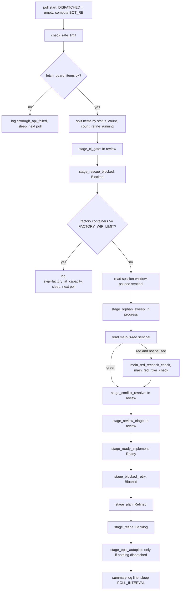

# The scheduler: how the factory decides what to run

`scheduler.sh` is a single long-running bash process (the `backlog-scheduler` service in
`deploy/docker-compose.yml`). Every `POLL_INTERVAL` seconds it reads the project board,
runs a fixed sequence of stages, and starts run containers (normally one per poll) with
`docker compose run`. It never does ticket work itself.

This document describes `origin/main` as the code stands. It was first written against
commit `254c9d2` and revised against `64cd44a` for three later changes:
[PR #519](https://github.com/omniscient/dark-factory/pull/519) (per-scenario budget files),
[PR #524](https://github.com/omniscient/dark-factory/pull/524) (the autopilot adapter
lookup) and [PR #525](https://github.com/omniscient/dark-factory/pull/525) (issue comments,
the board read and the off-board check now go through the provider CLI). Every claim cites
the file it came from. Things that look inconsistent or wrong are collected in
[Open questions / oddities](#open-questions--oddities) rather than smoothed over.

Related documents:

- What a run container does once it is dispatched: [run-lifecycle.md](run-lifecycle.md).
- What each config key and env var means and its default: [configuration.md](configuration.md).
- Setting up a new target repo and instance: [onboarding-new-target.md](onboarding-new-target.md).
- Label meanings: [triage-labels.md](triage-labels.md).

Source files: `scheduler.sh`, `scripts/scheduler_lib.sh` (pure label/size predicates),
`scripts/provider_env.sh`, `scripts/identity.sh`, `scripts/factory_core/` (`factory_core/cli.py`,
`breaker.py`, `board.py`, `rescue.py`, `epic_autopilot.py`, `session_window.py`,
`error_signature.py`, `main_red_fixer.py`, `providers/`), `run-compose.yml`,
`deploy/docker-compose.yml`, `config/config.yaml`.

## Contents

1. [Boot sequence](#boot-sequence)
2. [The poll loop](#the-poll-loop)
3. [Stage inventory](#stage-inventory)
4. [Dispatch](#dispatch)
5. [Limits, gating and retries](#limits-gating-and-retries)
6. [Persisted state](#persisted-state)
7. [Safety mechanisms](#safety-mechanisms)
8. [Labels as the scheduler implements them](#labels-as-the-scheduler-implements-them)
9. [Reading the scheduler log](#reading-the-scheduler-log)
10. [Running two instances side by side](#running-two-instances-side-by-side)
11. [Open questions / oddities](#open-questions--oddities)

## Boot sequence

The order below is the order the code executes. Steps 1 to 4 are top-level statements
that run before the function definitions; steps 5 onward run after the
`SCHEDULER_SOURCE_ONLY` guard (`scheduler.sh:1465`), which lets tests source the file
without starting the loop.

| # | Step | What happens | Source |
|---|------|--------------|--------|
| 1 | Source helpers | `scripts/identity.sh` (exports `FACTORY_*` identity, defaults are MarketHawk's), `scripts/scheduler_lib.sh`, `scripts/provider_env.sh` | `scheduler.sh:14-16`, `scripts/identity.sh` |
| 2 | Provider preflight | `providers/cli.py preflight`. Under `set -e` a non-zero exit stops the scheduler. It checks that `FACTORY_TRACKER` / `FACTORY_CODEHOST` / `FACTORY_MODEL_PROVIDER` name known providers and that each one's required env is set: `GH_TOKEN` for the GitHub tracker and code host, and `CLAUDE_CODE_OAUTH_TOKEN` or `ANTHROPIC_API_KEY` for the `anthropic` model provider | `scheduler.sh:45`, `providers/__init__.py` `preflight()`, `providers/model.py` |
| 3 | Provision the run env file | Copies `/workspace/project/.archon/.env` to `/opt/dark-factory/.archon/.env`, the path `run-compose.yml`'s `env_file` resolves to. If the source is missing it only warns; every later dispatch then fails env-file resolution. The copy is made once, at boot | `scheduler.sh:53-59`, `run-compose.yml` (`env_file`) |
| 4 | State directory | `mkdir -p $SCHEDULER_STATE_DIR` (default `/var/lib/dark-factory`) and create `scheduler-state.json` as `{}` if absent | `scheduler.sh:10-11`, `:62-67` |
| 5 | Config resolution | `read_config` runs `factory_core.effective_config` in scheduler mode: the first existing file of `/workspace/project/config/config.yaml`, `/opt/dark-factory/config/config.yaml`, `/opt/refinement-skills/config.yaml` (`SCHEDULER_CANDIDATES`), whole-file, no merge, never a clone, written to `$SCHEDULER_STATE_DIR/run-config.{json,env}`. No file found, or a missing or empty `run-config.env`, is fatal (`FATAL: cannot read config.yaml`, exit 1). Each knob is then set by `apply_run_config_env` (below) | `scheduler.sh:35-42`, `scripts/factory_core/effective_config.py:33-37`, `scheduler.sh:1470` |
| 6 | ERR trap | Logs `SCHED_UNHANDLED_ERR line=… exit=…` for any unhandled failing command. The process still exits (`set -e`); compose restarts it (`restart: unless-stopped`) | `scheduler.sh:1477-1481`, `deploy/docker-compose.yml` |
| 7 | WIP limits | `tracker get-status-limits`, once, cached until restart. See [WIP limits](#wip-limits) | `scheduler.sh:1484-1487` |
| 8 | Image check | `docker image inspect $FACTORY_IMAGE`; if absent, `docker pull`; if the pull fails, print instructions, sleep 60 s and exit 1 | `scheduler.sh:1493-1508` |
| 9 | Stale preview warning | Warns when more than `STALE_PREVIEW_WARN_COUNT` (env only, default 3) containers named `mh-preview-*` exist. Never blocks | `scheduler.sh:1511-1521` |
| 10 | Adapter validation warning | If `/workspace/project/.factory/adapter.yaml` exists, runs `python3 -m factory_core.adapter --validate` and logs `WARNING: ADAPTER INVALID …` on failure. Warn-only: the mounted checkout may be stale, and the run container's own check is the enforcement point | `scheduler.sh:1526-1533` |
| 11 | Loop start | Logs `Backlog scheduler started (poll every ${POLL_INTERVAL}s)` | `scheduler.sh:1536` |

### `apply_run_config_env`: config value versus environment

`read_config` (`scheduler.sh:35-42`) has `factory_core.effective_config`
write the resolved file's whitelisted knobs to `$SCHEDULER_STATE_DIR/run-config.env`,
one `VAR=value` line each (a bare `VAR` for a missing or null key). Then
`apply_run_config_env <file> scheduler` (`scripts/run_config_env.sh`) walks the file. It
parses the file and never `source`s it:

- If `VAR` is already set in the environment, **even to an empty string**, the
  environment wins. When it differs from the config value the scheduler logs
  `[config] VAR=<env> (env override; config has '<cfg>')`.
- Otherwise `VAR` is exported with the config value. A missing or null key becomes an
  empty string.

The knobs read this way are the `scheduler` rows of `ENV_WHITELIST`
(`scripts/factory_core/effective_config.py:43-80`): poll interval, retry limit,
rate-limit floor, factory and refine WIP limits, main-red recheck and autofix settings,
blocked rescue, `direct-to-pr` label and grace minutes, conflict resolution, dispatch
ceiling, epic autopilot, and four `token_optimization.*.enabled` flags. Adding a
bash-consumed knob is one row there. Their meanings and defaults belong to
[configuration.md](configuration.md).

Not read from `config.yaml` at all: `REFINE_MAX_RETRIES` (env only, default 3,
`scheduler.sh:22-24`), `SCHEDULER_STATE_DIR`, `STALE_PREVIEW_WARN_COUNT`,
`FACTORY_MODEL_PROXY_ENABLED`, and the skip-label lists, which are constants in the
script (`scheduler.sh:9`, `:23`).

`read_config` exports into the scheduler's own process. That reaches the things the
scheduler runs in-process (for example `epic-autopilot --once`, which reads
`EPIC_AUTOPILOT_*` from the environment, `epic_autopilot.py` `main_once()`), but it does
not reach run containers; see [Dispatch](#dispatch).

## The poll loop



The loop body is `scheduler.sh:1538-1658`.

### What is fetched each poll

Fixed cost, every poll:

| Call | API | Source |
|------|-----|--------|
| `tracker get-rate-budget` → `gh api rate_limit --jq .resources.graphql` | REST | `check_rate_limit`, `scheduler.sh:70-85`; `providers/tracker/github.py` `get_rate_budget()` |
| Board fetch: `providers/cli.py tracker board-items`, which runs `gh api graphql` with `items(first: 100)` per page, following `endCursor` until `hasNextPage` is false. One call per 100 board items. Each item carries status name, issue number, title and the first 10 labels | GraphQL | `fetch_board_items`, `scheduler.sh:604-609`; `providers/tracker/github.py` `list_board_items()` (`:223`) and the query template (`:23`) |
| `tracker get-rate-budget` again, for the `graphql=` field of the summary line | REST | `scheduler.sh:1638-1639` |
| Only when the poll dispatched nothing: `providers/cli.py tracker list-items --label ready-for-agent --limit 200`, which runs `gh issue list --repo <slug> --state open --label ready-for-agent --limit 200 --json number` | `gh` subcommand | `off_board_ready_issues`, `scheduler.sh:616-632`, `:1645`; `providers/tracker/github.py` `list_items()` (`:264`) |

A failed board fetch logs `error=gh_api_failed` and skips the whole poll
(`scheduler.sh:1546`). Since [PR #525](https://github.com/omniscient/dark-factory/pull/525)
`tracker board-items` exits 1 when a page body cannot be parsed as JSON (an empty body
included) or when a page reports `hasNextPage` without a cursor, and that is what triggers
the skip. The exit status of `gh` itself is not consulted: a parseable body without items,
such as a GraphQL error response, yields an empty item list rather than a failure, so the
poll then runs on an empty board (`providers/tracker/github.py` `list_board_items()`,
comment at `:224-228`; read from the code, not exercised here). Items that are not issues
are dropped in the same function (`content.number` absent).

Everything else is per item, issued by the stages. None of it is cached between stages
or polls, except the comment-classifier verdict:

| Stage | Calls per item it looks at |
|-------|----------------------------|
| `stage_ci_gate` | `gh pr list --search head:feat/issue-N-`; if a PR exists, `gh pr checks`. On a red PR: a board move (`gh project item-list --limit 200` + `gh project item-edit`, `board.py`) and a comment through `tracker add-comment` |
| `stage_rescue_blocked` | `gh pr list` and `gh pr checks`; on rescue a second `gh pr list`, optionally `gh pr ready`, a board move, and a comment upsert (`rescue.py`, `board.py` `post_or_update_comment`) |
| `stage_orphan_sweep` | Only for orphans: board move + a comment through `tracker add-comment` |
| `stage_conflict_resolve` | `gh pr list`, then `gh pr view --json mergeable` |
| `stage_review_triage` | With `direct-to-pr`: `gh pr list` + `gh pr view --json reviews`. Then `gh issue view --json comments`. With new comments and no cached verdict: one `claude -p --model haiku` call |
| `stage_ready_implement` | `gh issue view --json body`; one `gh issue view --json state` per dependency that is not on the board |
| `stage_blocked_retry` | `git ls-remote` over smart HTTP (no API quota, per the comment at `scheduler.sh:527-547`); `gh pr list` only when no branch was found |
| `stage_plan`, `stage_refine` | Gate-labelled items: `gh issue view --json comments`, twice when the grace timer is evaluated. On dispatch: a comment through `tracker add-comment` |
| `stage_epic_autopilot` | One board GraphQL query for in-progress epics, one sub-issue GraphQL query per epic, one `gh issue view` per gated child, optionally a Contents API read and a `claude -p` review (`epic_autopilot.py`) |

So an In review ticket costs up to three PR lookups per poll (CI gate, conflict gate,
end gate). The argv for each call is in `providers/tracker/github.py` and
`providers/codehost/github.py`. Whether a given `gh` subcommand is served by GraphQL or
REST is decided inside the `gh` CLI and is not stated in this repo; only the calls
written as `gh api graphql` are provably GraphQL from the code.

Plain comments posted by the scheduler (the "Starting…" comments, the CI-gate, orphan and
ceiling comments, the feedback re-run comments) use `tracker add-comment`
(`providers/tracker/github.py` `add_comment()`, `:175`), which runs
`gh issue comment <n> --repo <slug> --body …`. Still direct `gh`, outside the provider
layer: board moves (`set_board_status` → `factory_core/cli.py board-move` →
`board.py`, `gh project item-list` and `item-edit`), the rescue comment upsert
(`board.py` `post_or_update_comment`), and `smoke_gate.sh`. Tracking issue:
[#507](https://github.com/omniscient/dark-factory/issues/507) (open).

### The rate budget

The code does not hardcode an hourly limit. It reads GitHub's GraphQL bucket
(`remaining`, `reset`, `used`, `limit`) for whatever token `gh` is using and:

- before each poll, if `remaining <= RATE_LIMIT_FLOOR` (config default 200), sleeps until
  `reset + 5 s` and logs `rate_limit remaining=… sleeping=…s until_reset`
  (`scheduler.sh:70-85`). A failed budget lookup is ignored (`|| return 0`);
- prints `graphql=<used>/<limit>` on the summary line (`graphql=?` if the lookup fails).

The budget belongs to the token, so two instances that use the same `GH_TOKEN` draw
from one bucket, together with anything else using that token. The guard only watches the
GraphQL bucket; REST and search limits are not checked.

## Stage inventory

Stages run in this order every poll. "Guard" is the stage-level condition from
`STAGE_GUARD` / `dispatch_stage` (`scheduler.sh:1419-1459`): `red_or_paused` skips the
stage when main is red or the session window is paused, `paused_only` skips it only
during a session-window pause, `none` always runs. All per-item stages below the
capacity guard stop at the first item once `DISPATCHED` is set (`[ -n "$DISPATCHED" ] && break`),
so one poll normally starts one run.

"Global skip" means `SKIP_LABELS` = `needs-discussion`, `epic`, `ready-for-human`
(`scheduler.sh:9`, `has_skip_label` `:641-652`). "Refine skip" means
`REFINE_SKIP_LABELS` = global skip plus `spec-pending-review`, `plan-pending-review`
(`scheduler.sh:23`, `has_refine_skip_label` in `scheduler_lib.sh`).

| Order | Stage function | Board status | Guard | Acts on an item when | What it does | Skips | Limits |
|-------|----------------|--------------|-------|----------------------|--------------|-------|--------|
| P0 | `stage_ci_gate` (`scheduler.sh:972-1002`) | In review | None. Runs before the capacity guard, so even while the factory is full | An open PR exists for `feat/issue-N-` and at least one check has `bucket == "fail"` | Moves the ticket to Blocked, comments with the failing checks, adds it to `CI_BLOCKED`. No dispatch | Global skip | None; every red ticket is gated in the same poll |
| P0.6 | `stage_rescue_blocked` (`:1014-1031`, `rescue.py`) | Blocked | `BLOCKED_RESCUE_ENABLED` (default true). Runs before the capacity guard | No run container for the issue, and its PR has at least one check, none failing, none pending, and `mergeable == MERGEABLE` | Marks a draft PR ready, moves the ticket to In review, upserts a "Rescued from Blocked" comment, resets retry key `N`, adds it to `RESCUED`. Never merges. No dispatch | Global skip; `above-ceiling` label | None |
| — | Capacity guard (`:1572-1577`) | — | — | Running containers whose name contains `FACTORY_RUN_PREFIX` ≥ `FACTORY_WIP_LIMIT` | Logs `skip=factory_at_capacity running=a/b`, sleeps, starts the next poll. Nothing below runs and no summary line is printed | — | `FACTORY_WIP_LIMIT` |
| — | Session-window sentinel (`:1586-1601`) | — | — | `session-window-paused` exists and its epoch is in the future | Sets `SESSION_WINDOW_PAUSED=true`. An expired or corrupt sentinel is deleted | — | — |
| sweep | `stage_orphan_sweep` (`:1041-1056`) | In progress | `paused_only` | No container command contains `#N` | Moves the ticket to Blocked and comments "Orphaned Run Recovered". No dispatch | Global skip | None |
| — | Main-red sentinel (`:1611-1621`) | — | — | `main-is-red` exists | Sets `MAIN_IS_RED=true`. Unless paused, may dispatch `Recheck main` and `Fix main` (see [Main-red](#main-red-detection-recheck-and-autofix)) | — | Recheck and fixer throttles |
| — | Dependency-health loop (`deps_audit_check`) | — | — | `DEPS_AUDIT_ENABLED=true` in the scheduler's environment, no session-window pause, nothing dispatched yet in this poll, no `Audit deps` container of this instance running, the interval has elapsed and no `deps/audit-` PR is open | Dispatches `Audit deps` and touches `deps-audit-last-run`. Runs whether or not main is red. Ships off | — | `DEPS_AUDIT_INTERVAL_HOURS` (default 24), scheduler environment only |
| P1.5 | `stage_conflict_resolve` (`:1063-1127`) | In review | `red_or_paused`; `CONFLICT_RESOLUTION_ENABLED` | Not in `CI_BLOCKED`, not running, breaker checks pass, PR exists and mergeability is `CONFLICTING`. `UNKNOWN` is logged and skipped | Dispatches `Deconflict issue #N` | Global skip | Retry key `N:resolve`, ceiling `MAX_RETRIES` |
| P1 | `stage_review_triage` (`:1130-1163`) | In review | `none` | Not in `CI_BLOCKED`. First `end_gate_check`; if that does not act, new comments since the last factory comment are classified | End gate or verdict `MERGE` → `Close issue #N` via `dispatch_close` (only if not already running; counts on `N:close`, trips to Blocked past `MAX_RETRIES`). `CHANGES_REQUESTED` or verdict `CONTINUE` → `Continue issue #N` (only if not already running) and reset retry key `N`. `SKIP` → nothing | Global skip | None |
| P2 | `stage_ready_implement` (`:1166-1212`) | Ready | `red_or_paused` | In progress and In review columns are under their WIP limits, dependencies are met, not running, not above the dispatch ceiling | Dispatches `Fix issue #N`. Above-ceiling items are labelled, moved to Blocked and commented on instead | Global skip | `MAX_IN_PROGRESS`, `MAX_IN_REVIEW` (stage stops), dependency gate, dispatch ceiling |
| P3 | `stage_blocked_retry` (`:1215-1269`) | Blocked | `red_or_paused` | Not rescued this poll, no `above-ceiling` label, not running, breaker checks pass | Dispatches `Continue issue #N` if a `feat/issue-N-*` branch or an open PR exists, else `Fix issue #N` | Global skip; `above-ceiling` label; `RESCUED` | Retry key `N`, ceiling `MAX_RETRIES` |
| P4 | `stage_plan` (`:1272-1333`) | Refined | `paused_only` | Not running, `REFINE_RUNNING < REFINE_WIP_LIMIT`, breaker checks pass. Items with `plan-pending-review` **and** `direct-to-pr` go to `plan_advance_check` instead | Comments "Starting plan generation" and dispatches `Plan issue #N` | Refine skip | `REFINE_WIP_LIMIT` (stage stops); retry key `N:plan`, ceiling `REFINE_MAX_RETRIES` |
| P5 | `stage_refine` (`:1336-1400`) | Backlog | `paused_only` | Carries `ready-for-agent` or `direct-to-pr`, not running, `REFINE_RUNNING < REFINE_WIP_LIMIT`, breaker checks pass. Items with `spec-pending-review` go to `spec_advance_check` instead | Comments "Starting brainstorming" and dispatches `Refine issue #N` | Refine skip | `REFINE_WIP_LIMIT` (stage stops); retry key `N:refine`, ceiling `REFINE_MAX_RETRIES` |
| P6 | `stage_epic_autopilot` (`:1407-1413`) | (its own queries) | Own condition: nothing dispatched this poll, main green, not paused, `EPIC_AUTOPILOT_ENABLED=true` | See [Epic autopilot](#epic-autopilot) | Runs `cli.py epic-autopilot --once` in the scheduler process. May add `direct-to-pr` to one child or start one epic. Starts no container itself | Its own eligibility rules | Daily cap |

Items are processed in the order the board query returns them; the scheduler applies no
priority ordering of its own within a status (`get_items_by_status`, `scheduler.sh:634-639`).
Status names are compared case-insensitively.

### Notes on individual stages

**"Running" means a container, not a board status.** `is_issue_running`
(`scheduler.sh:115-121`) greps the command column of `docker ps` for `#N`.
`count_refine_running` (`:244-246`) counts commands containing `Refine issue` or
`Plan issue`. `count_factory_running` (`:123-125`) counts container names containing
`FACTORY_RUN_PREFIX`.

**Breaker checks** (P1.5, P3, P4, P5 share this sequence; see
[Circuit breaker](#circuit-breaker)):

1. `check_failure_signature` consumes the failure-signature drop file from the last run.
   `stuck=true` trips the breaker.
2. `rollback_paused_retry` gives back one retry if the last attempt was a session-window pause.
3. `retry_or_skip_delivery_failure` exempts a runner-side delivery failure from the
   normal counter, up to the same ceiling.
4. Otherwise `evaluate_stop` trips at the ceiling or counts the attempt.

**Review triage** (`stage_review_triage`):

- `end_gate_check` (`scheduler.sh:325-357`) applies only to `direct-to-pr` tickets with
  an open PR. It reads the last review whose state is `APPROVED` or `CHANGES_REQUESTED`
  (`providers/codehost/github.py` `get_change_reviews()`). `APPROVED` dispatches
  `Close issue #N` through `dispatch_close` (`:368`), the same guard and `N:close` breaker
  the `MERGE` verdict uses; `CHANGES_REQUESTED` dispatches `Continue issue #N`. Any other state
  falls through to comment classification.
- `get_new_comments` (`:761-784`) returns the issue comments after the last one matching
  `Posted by <product> Dark Factory`; if there is no such comment, all comments.
- `classify_comments` (`:850-938`) asks `claude -p --model haiku` for one word.
  `parse_comment_verdict` (`:786-848`) accepts `MERGE` only when it is the whole reply
  (ignoring punctuation other than `?`), accepts `CONTINUE` / `SKIP` as the leading
  token, and treats a reply containing two different all-caps verdict tokens as
  unparseable. An API error or unparseable reply becomes `SKIP` and is not cached.
  A parsed verdict is cached in `scheduler-state.json` under `N:cverdict` keyed by the
  latest comment id (`N:cid`), so the model is called once per new comment.
  `tests/test_scheduler_comment_verdict.py` pins the grammar.

**Ready** (`stage_ready_implement`): the WIP checks use `break`, so a full In progress
or In review column stops the whole stage, while an unmet dependency or an above-ceiling
item only skips that item.

**Blocked retry**: branch detection is a `git ls-remote --heads` for
`refs/heads/feat/issue-N-*` with a 30 s timeout. Any probe error is treated as "no
branch" and logged as `branch_probe_error` (`branch_exists_for_issue`,
`scheduler.sh:548-573`); the PR lookup is then the fallback.

**Plan and refine** post their "Starting…" comment before calling `dispatch`, and append
a note when the previous attempt was a delivery failure or a session-window pause
(`delivery_skip_note`, `session_window_pause_note`, `scheduler.sh:493-514`).

## Dispatch

`dispatch "<command>"` (`scheduler.sh:388-405`) runs:

```
docker compose -f /opt/dark-factory/docker-compose.yml --profile factory \
  [--profile factory-model-proxy] run [-e NAME ...] -d --rm dark-factory "<command>"
```

- `/opt/dark-factory/docker-compose.yml` is `run-compose.yml`, baked into the image
  (`Dockerfile`, `COPY run-compose.yml /opt/dark-factory/docker-compose.yml`).
- `--profile factory-model-proxy` is added when `FACTORY_MODEL_PROXY_ENABLED=true` in the
  scheduler's environment.
- `-d` detaches: the scheduler does not wait for the run. `dispatch` returns the
  `docker compose` exit code, so "success" means the container was started. A failure
  logs `dispatch_error command="…" exit=N`.
- Every caller wraps it in `if dispatch …; then DISPATCHED=…`.
- The scheduler talks to Docker through its socket proxy
  (`DOCKER_HOST=tcp://docker-socket-proxy-scheduler:2375`, `deploy/docker-compose.yml`).

The command string is the whole interface to the run container. The scheduler sends
these:

| Command | Sent by |
|---------|---------|
| `Refine issue #N` | `stage_refine`; `spec_advance_check` on feedback |
| `Plan issue #N` | `stage_plan`; `plan_advance_check` on feedback |
| `Fix issue #N` | `stage_ready_implement`; `stage_blocked_retry` when no branch or PR exists |
| `Continue issue #N` | `stage_blocked_retry` when a branch or PR exists; `stage_review_triage` / `end_gate_check` |
| `Close issue #N` | `stage_review_triage` (verdict `MERGE`); `end_gate_check` (`APPROVED`) |
| `Deconflict issue #N` | `stage_conflict_resolve` |
| `Recheck main` | `main_red_recheck_check` |
| `Fix main` | `main_red_fixer_check` |
| `Audit deps` | `deps_audit_check` |

`entrypoint.sh:99-108` turns the first word into the run's intent. What each intent
does is in [run-lifecycle.md](run-lifecycle.md).

### What environment reaches the run container

Three sources, all visible in `run-compose.yml` and `scripts/provider_env.sh`:

| Source | Carries | Notes |
|--------|---------|-------|
| `env_file: .archon/.env` → `/opt/dark-factory/.archon/.env` | Secrets (`GH_TOKEN`, Claude credentials) and any run-side settings | This is the copy of `<PROJECT_DIR>/.archon/.env` made at scheduler boot (`scheduler.sh:53-59`). It is `required: true`. |
| `environment:` in `run-compose.yml`, interpolated from the **scheduler's** environment at dispatch | `DOCKER_HOST`, `SEQ_URL`, all `FACTORY_*` identity vars, `FACTORY_IMAGE`, `FACTORY_RUN_PREFIX`, the four `ANTHROPIC_DEFAULT_*_MODEL` pins, `BUILDKIT_HOST` / `BUILDKIT_PORT` | Identity comes from `deploy/instance.env` via the scheduler. Per the comment in `provider_env.sh`, an `environment:` entry beats `env_file`. |
| `docker compose run -e NAME`, from `provider_env_flags` | Provider selection and provider env (`FACTORY_TRACKER`, `FACTORY_CODEHOST`, `FACTORY_MODEL_PROVIDER`, Jira, GitLab, Bedrock, Vertex vars; full list in `PROVIDER_PASSTHROUGH_VARS`) | Forwarded only when set and non-empty in the scheduler's environment; then it overrides `.archon/.env`. `GH_TOKEN`, `CLAUDE_CODE_OAUTH_TOKEN` and `ANTHROPIC_API_KEY` are deliberately not forwarded. |

Consequences that follow directly from this:

- `deploy/instance.env` configures the scheduler. Apart from the identity block and the
  provider pass-through list, nothing in it reaches a run
  (`deploy/instance.env.example:9-10`, `:127-132`).
- Values the scheduler takes from `config.yaml` via `read_config` stay in the scheduler
  process. A feature whose run-side half reads an env var must also have that var in
  `.archon/.env`. `config/config.yaml:120-122` says this about `MAIN_RED_AUTOFIX_ENABLED`,
  and `entrypoint.sh` (the `fix-main` branch) confirms the run container checks it again.
- The run container mounts the same state volume at `/var/lib/dark-factory`
  (`run-compose.yml`, `scheduler_state`), which is how sentinels and failure signatures
  travel back.

## Limits, gating and retries

### WIP limits

| Limit | Where it comes from | Enforced by |
|-------|---------------------|-------------|
| `MAX_IN_PROGRESS`, `MAX_IN_REVIEW` | The board itself: the description of each Status option is searched for `limit: <n>`; no match, or a failed query, means 999. Read once at boot and logged as `WIP limits: in_progress=… in_review=… factory=…` | `providers/tracker/github.py` `get_status_limits()`; `scheduler.sh:1484-1487`; checked only in `stage_ready_implement` (`:1171-1172`) against the item counts from this poll's board snapshot |
| `FACTORY_WIP_LIMIT` (config default 1) | `scheduler.factory_wip_limit` or env | The capacity guard, `scheduler.sh:1572-1577`. It counts every run container of this instance, whatever its intent |
| `REFINE_WIP_LIMIT` (config default 2) | `refine.wip_limit` or env | `stage_plan`, `stage_refine` and the two advance checks, against the number of running `Refine issue` / `Plan issue` containers plus those dispatched this poll |

Changing a board limit needs a scheduler restart, because the limits are cached at boot.

### Dependency gating

`dependencies_met` (`scheduler.sh:721-758`) is called only by `stage_ready_implement`.
It reads the issue body and `_scan_body_for_deps` (`:685-719`) collects issue numbers
from:

- any line containing `Depends on:` (case-insensitive; `*` emphasis is stripped first;
  several `#N` on one line all count);
- bullets under a heading whose text is `Blocked by`, up to the next heading.

Fenced code blocks and inline code spans are removed first; an unclosed fence hides
everything after it.

For each dependency: if it is on the board, its status must be exactly `Done`. If it is
not on the board, the issue state is fetched; `CLOSED` passes (`resolved=closed_off_board`),
anything else, including a failed lookup, blocks. A blocked item logs a `dep_gate` line
and is skipped for this poll. `tests/test_scheduler.sh` section N covers these cases.

### Size and type dispatch ceiling

Predicates are in `scripts/scheduler_lib.sh`; the size comes from the first label
matching `size: ?(xl|s|m|l)`.

| Size label | `is_above_ceiling` (parks a Ready item) | `is_below_ceiling` (plan grace auto-advance allowed) |
|------------|------------------------------------------|------------------------------------------------------|
| none | no | yes |
| `size: S` | no | yes |
| `size: M` | only if the title matches `ABOVE_CEILING_KEYWORDS` | no |
| `size: L` | no | yes |
| `size: XL` | yes | no |

When `DISPATCH_CEILING_ENABLED` is true and a Ready item is above the ceiling,
`stage_ready_implement` adds `ABOVE_CEILING_LABEL` (default `above-ceiling`), moves the
ticket to Blocked and posts "Above Dispatch Ceiling" once; the label is what stops the
comment repeating (`scheduler.sh:1179-1206`). While the label is present,
`stage_rescue_blocked` and `stage_blocked_retry` leave the ticket alone.

### Retries and retry counters

All counters are integer entries in `scheduler-state.json`, managed by
`factory_core/breaker.py` through `cli.py breaker-*` subcommands. The key is the bare
issue number for the implement phase and `N:<phase>` otherwise (`breaker.py` `_make_key`).

| Key | Counted when | Ceiling | Reset when |
|-----|--------------|---------|------------|
| `N` | Each `stage_blocked_retry` attempt (`evaluate_stop`, `scheduler.sh:1246`) | `MAX_RETRIES` | `Continue` dispatched from In review (`:348`, `:1156`); blocked rescue (`:1027`); breaker trip |
| `N:plan` | Each `stage_plan` attempt (`:1313`) | `REFINE_MAX_RETRIES` | Re-plan on feedback (`:291`); breaker trip |
| `N:refine` | Each `stage_refine` attempt (`:1380`) | `REFINE_MAX_RETRIES` | Re-refine on feedback (`:255`); breaker trip |
| `N:resolve` | Each `Deconflict` dispatch (`:1116`); the ceiling check itself is a `--peek` (`:1098`) | `MAX_RETRIES` | Breaker trip |
| `N:close` | Each `Close` dispatch through `dispatch_close` (`evaluate_stop`, `:372`) | `MAX_RETRIES` | Breaker trip |
| `<key>:delivery` | A delivery-failure attempt that was exempted from `<key>` | same ceiling as `<key>` | With `<key>` |
| `<key>:sig` | Last failure signature seen for `<key>` | — | With `<key>` |

`evaluate_stop_condition` (`breaker.py`) reports `stopped` when the count is already at
the ceiling and otherwise increments it. With a ceiling of 3 that is three counted
dispatches; the fourth evaluation trips the breaker. The count is taken before
`dispatch` runs and is not undone if `docker compose run` itself fails, so repeated
dispatch errors also end in a trip. `reset_retry` removes the key together with its
`:sig`, `:delivery`, `:loop:*`, `:cverdict`, `:cid` and `:crawlog` companions.

The first `Fix issue #N` from Ready, `Close`, `Continue` from review, `Recheck main` and
`Fix main` are not counted. Neither is `Audit deps`, which has no ticket and no retry key.

## Persisted state

Everything lives under `SCHEDULER_STATE_DIR` (default `/var/lib/dark-factory`), which is
the named volume `<FACTORY_INSTANCE>-scheduler-state` mounted into both the scheduler
(`deploy/docker-compose.yml`, `dark_factory_state`) and every run container
(`run-compose.yml`, `scheduler_state`). The two volume names must stay identical.

| Path | Written by | Read by | Purpose |
|------|-----------|---------|---------|
| `scheduler-state.json` | Scheduler via `breaker.py` (atomic tmp + rename) | Scheduler | Retry counters, failure signatures, comment-verdict cache |
| `error-signatures/<N>.<phase>.sig` | Run container (`error_signature.py` `write_signature`) | Scheduler, which deletes it on read (`breaker.py` `record_failure_signature`) | Failure class of the last failed run |
| `session-window-paused` | Run container (`session_window.py` `write_pause_sentinel`) | Scheduler (`scheduler.sh:1586-1601`) | Resume epoch for the session-window pause |
| `main-is-red` | Run container (`smoke_gate.sh` `_smoke_on_red`); removed by `_smoke_on_green` | Scheduler (`:1612`) | Main-red latch |
| `main-is-red-issue` | Run container (`smoke_gate.sh`) | `main_red_fixer.py` | Regression ticket number |
| `main-red-last-recheck` | Scheduler (`:161`) and `smoke_gate.sh` on red; removed on green | Scheduler `recheck_due` | Recheck throttle (file mtime) |
| `main-red-fixer-last-run` | Scheduler (`:187`) | Scheduler `fixer_due` | Fixer throttle (file mtime) |
| `main-red-fixer-state.json` | `main_red_fixer.py` in the `Fix main` run | Same | Attempts per regression ticket |
| `deps-audit-last-run` | Scheduler (`deps_audit_check`) | Scheduler `deps_audit_due` | `Audit deps` throttle (file mtime) |
| `deps-fixer-state.json` | `deps_fixer.py` in the `Audit deps` run | Same | Attempts per advisory-set hash |
| `autopilot-state.json` | `epic_autopilot.py` in the scheduler process | Same | Daily advance count, cached verdicts |
| `runs.jsonl` | Run containers (`entrypoint.sh`); scheduler appends a `stop_condition` row when `evaluate_stop` reports a stop (`breaker.py` `_append_stop_audit_row`) | Reporting | Run ledger |

Because retry state is on the volume, counters survive a scheduler restart
(`scheduler.sh:1472-1476`).

## Safety mechanisms

### Circuit breaker

What trips it (all in the four breaker-checked stages; review triage's `Close` dispatch,
`dispatch_close` (`:368`), checks the retry ceiling only):

1. **Retry ceiling.** The counter for the phase is already at its ceiling
   (`evaluate_stop`). Reason text: `retry limit of N reached`.
2. **Same substantive failure twice.** A failed run writes a signature such as
   `substantive:test_failure:1` or `environmental:rate_limit`
   (`error_signature.py` `classify`). `record_failure_signature` returns `stuck` when the
   new signature starts with `substantive:` and equals the previous one for that key.
   Environmental signatures never count as stuck.
3. **Delivery failures up to the ceiling.** `environmental:delivery_failure` (a run
   that ended in under 30 s by default, with no commits, a clean worktree and no
   artifact; `error_signature.py` `classify`) is not
   charged to the normal counter; a shadow counter `<key>:delivery` is. When the shadow
   counter reaches the ceiling the normal counter is back-filled and the breaker trips
   (`retry_or_skip_delivery_failure`, `scheduler.sh:471-487`; the conflict stage does the
   same inline, `:1088-1096`, `:1112-1114`).

What it does (`breaker.py` `trip_to_blocked`): moves the ticket to Blocked, adds the
labels `needs-discussion` and `factory-regression`, posts "Circuit-Breaker Tripped
(`<phase>`)" with the attempt count and reason, then resets the counter. Because
`needs-discussion` is a global skip label, every stage now ignores the ticket until a
human removes it. The scheduler logs `circuit_breaker=trip issue=#N phase=<phase>`. A
retry-ceiling stop also appends a `stop_condition` audit row to `runs.jsonl`
(`evaluate_stop_condition`); the signature and delivery-failure trips do not go through
that function.

### Session-window pause

When a run detects that the Claude session window is exhausted, the run container
writes `session-window-paused` containing a resume epoch, and a signature
`environmental:session_window_pause` (`entrypoint.sh` `_handle_session_window_pause`,
`session_window.py`). The resume time is the reset time found in the output plus a
buffer, or a fallback number of minutes, never more than 5 h plus the buffer ahead
(`compute_resume_epoch`).

In the scheduler (`scheduler.sh:1586-1601`), while the epoch is in the future:

- `SESSION_WINDOW_PAUSED=true`, logged as `session_window_gate=active resume_at=<iso>`;
- skipped: orphan sweep, conflict resolution, Ready, Blocked retry, plan, refine, the
  main-red recheck and fixer, and epic autopilot;
- still running: CI gate, blocked rescue, and review triage (guard `none`).

Once the time passes the sentinel is deleted on the next poll. The attempt that was
interrupted is not charged: `rollback_paused_retry` (`:443-451`) decrements the counter
when it sees the pause signature, and the next plan/refine "Starting…" comment says so.
The orphan sweep is deferred during a pause so that a run which ended by pausing is not
reclassified as orphaned.

### Main-red detection, recheck and autofix

The smoke gate inside `fix`, `continue`, `deconflict` and `recheck` runs writes
`main-is-red` when `origin/main` fails its checks and removes it when main is green
(`smoke_gate.sh`; details in [run-lifecycle.md](run-lifecycle.md)).

While the file exists (`scheduler.sh:1611-1621`):

- the scheduler logs `main_red_gate=active action=skip_implement_dispatch`;
- conflict resolution, Ready and Blocked retry are skipped; review triage, plan and
  refine are not; epic autopilot does not run;
- **Recheck**: if `MAIN_RED_RECHECK_ENABLED`, no `Recheck main` container is running and
  `main-red-last-recheck` is older than `MAIN_RED_RECHECK_MINUTES`, dispatch
  `Recheck main` and touch the stamp (`main_red_recheck_check`, `:155-164`). This is the
  only way the latch clears without a human, because the runs that could clear it are
  the ones being skipped;
- **Autofix**: if `MAIN_RED_AUTOFIX_ENABLED` (ships off), no `Fix main` container is
  running and `main-red-fixer-last-run` is older than `MAIN_RED_AUTOFIX_THROTTLE_MIN`
  (default 15), dispatch `Fix main` (`main_red_fixer_check`, `:181-190`). The run
  (`main_red_fixer.py` `run_once`) reproduces the failure, lets a `claude -p` agent edit
  within allowed paths, escalates to a human on an empty diff, an out-of-scope diff or
  after `MAIN_RED_AUTOFIX_MAX_ATTEMPTS`, and otherwise opens a PR and merges it only if
  its CI goes green.

Both are skipped during a session-window pause. Either dispatch sets `DISPATCHED`, so
the per-item stages that follow in the same poll do nothing.

### Rescue of blocked tickets

`stage_rescue_blocked` (P0.6) is the inverse of the CI gate: a Blocked ticket whose PR
is green and mergeable is promoted to In review instead of being re-run until the
breaker parks it. Conditions and effects are in the stage table; the decision logic is
`rescue.py` `assess()`. It can be turned off with `BLOCKED_RESCUE_ENABLED=false`.

### Orphan sweep

`stage_orphan_sweep` moves any In progress ticket with no matching container to Blocked,
where `stage_blocked_retry` picks it up. It exists for run deaths that cannot run their
own failure handler (host restart, OOM kill). It runs only when the factory is below
capacity and not paused.

### Conflict resolution

`stage_conflict_resolve` (P1.5) dispatches `Deconflict issue #N` for In review PRs that
GitHub reports as `CONFLICTING`. It runs before review triage so that conflicts are
handled before comments. The run resolves, validates, pushes and returns the ticket to
In review, or escalates (`entrypoint.sh`, deconflict flow; `factory_core/deconflict.py`).
`CONFLICT_RESOLUTION_ENABLED=false` disables the stage.

### CI gate

`stage_ci_gate` (P0) keeps red PRs out of In review. The ticket goes to Blocked; from
there `stage_blocked_retry` dispatches `Continue` (the PR and branch exist) to fix the
failures, or `stage_rescue_blocked` promotes it back if CI turns green on its own. A
ticket gated in this poll is in `CI_BLOCKED` and is skipped by the conflict and review
stages of the same poll.

### Grace-timer auto-advance for the spec and plan gates

Gate-labelled items are handled by `spec_advance_check` (`scheduler.sh:248-282`) and
`plan_advance_check` (`:284-323`). Both first return if the item has a global skip
label. Then:

1. **Feedback re-run.** If any comment after the last `Posted by <product> Refinement
   Pipeline` comment is not a factory comment (`has_new_comment_after_report`,
   `scheduler_lib.sh`, using `BOT_RE` from `cli.py markers-regex`), reset the phase
   counter, remove the gate label, comment "Re-running with new feedback", and dispatch
   `Refine issue #N` / `Plan issue #N`.
2. **Grace advance**, only with the `direct-to-pr` label: when the minutes since that
   last pipeline comment are ≥ `SPEC_GRACE_MINUTES` / `PLAN_GRACE_MINUTES`, remove the
   gate label and move the ticket to Refined / Ready (`spec_auto_advance`,
   `plan_auto_advance` log lines). Before that, log `…_grace_window … action=waiting`.
   For plans the ticket must also pass `is_below_ceiling` when the dispatch ceiling is
   enabled.

Who reaches these functions differs:

- `stage_refine` calls `spec_advance_check` for every Backlog item with
  `spec-pending-review`, with or without `direct-to-pr`.
- `stage_plan` calls `plan_advance_check` only for Refined items that carry both
  `plan-pending-review` and `direct-to-pr`.
- Both require that the issue is not running and `REFINE_RUNNING < REFINE_WIP_LIMIT`.

Without `direct-to-pr`, a gate is passed by a human: move the card and remove the label.
`tests/test_scheduler.sh` sections G and I pin these paths.

### End gate and auto-merge with `direct-to-pr`

For `direct-to-pr` tickets the PR review is the single gate (`end_gate_check`, described
under review triage). An `APPROVED` review dispatches `Close issue #N`; the merge itself
is done by that run. For tickets without the label, `Close` is dispatched only when the
comment classifier returns `MERGE`.

### Epic autopilot

Runs inside the scheduler process, at most once per poll, only when the poll dispatched
nothing, main is green, there is no session-window pause and `EPIC_AUTOPILOT_ENABLED` is
true (`scheduler.sh:1407-1413`). One pass (`epic_autopilot.py` `run_once`):

1. **Daily cap.** If today's (UTC) count has reached `EPIC_AUTOPILOT_DAILY_CAP`, stop
   with `daily_cap_reached`.
2. **Candidates.** For every board item with status `In progress` and label `epic`, take
   its open sub-issues that carry `plan-pending-review` or `spec-pending-review`
   (`_in_progress_epics`, `_sub_issue_numbers`), oldest issue number first.
3. **Eligibility** (`is_eligible`): dropped if it already has `direct-to-pr`, or has the
   opt-out label (default `no-autopilot`), `needs-discussion`, `epic` or
   `ready-for-human`, or its size is at or above `EPIC_AUTOPILOT_SIZE_CEILING` (default
   `XL`; unlabelled ranks below `S`).
4. **Hard exclusions** (`hard_excluded`): dropped if title + body match the sensitive
   keyword pattern, or a path mentioned in the spec/plan text contains one of the
   exclude paths. No declared paths is not a drop; the reviewer is told the scope is
   undeclared.
   - The keyword pattern is the union of `EPIC_AUTOPILOT_SENSITIVE_KEYWORDS`
     (config/env) and the adapter's `safety.sensitive_keywords`, joined as
     `(?:a)|(?:b)` (`_effective_sensitive_keywords`).
   - The adapter is read from `_target_dir()`: `CLONE_DIR` if set, else
     `/workspace/project` when it holds `.factory/adapter.yaml`, else `.`
     ([PR #524](https://github.com/omniscient/dark-factory/pull/524)).
   - Exclude paths are the union (`_effective_exclude_paths`) of what
     `_load_exclude_paths` yields for `CLONE_DIR` (or `.`) and for that target directory:
     the adapter's `safety.hard_exclude_paths`, else `config.yaml`, else built-in defaults.
     With `EPIC_AUTOPILOT_ALLOW_SELF_IMPROVEMENT=true` the four factory-self prefixes are
     removed from the list.
5. **Holds.** A candidate with a cached `HOLD` for the same spec text hash, younger than
   `EPIC_AUTOPILOT_HOLD_TTL_HOURS`, is skipped.
6. **Review.** The first remaining candidate is reviewed with `claude -p --model
   $EPIC_AUTOPILOT_MODEL`. It advances only on `decision=ADVANCE`, `risk=low` and
   `confidence >= EPIC_AUTOPILOT_CONFIDENCE_FLOOR`; anything unparseable is a `HOLD`.
   - Advance: add the `direct-to-pr` label, comment, count against the daily cap, cache
     `ADVANCE`. The grace timer then moves the ticket on later polls.
   - Hold: comment "parked (HOLD)" unless the stored HOLD is unchanged (same spec and
     review input), and cache it. Not counted against the cap. A skipped comment reports
     `hold_unchanged`. An unparseable review always comments and never becomes a dedup
     baseline. If the HOLD comment fails to post, the verdict is cached without its
     review-input digest, so the next cycle comments again.
7. **No candidates.** If `EPIC_AUTOPILOT_START_EPICS` is true, pick the next Ready epic
   (`pick_next_epic`: `must-have` before `should-have`, then board order, skipping titles
   or labels matching the exclude regex), move it to In progress, add `ready-for-agent`
   to its open children, and count it against the daily cap. Otherwise report
   `no_candidates`.

The scheduler sets `DISPATCHED` to the output line when the outcome is `advanced` or
`epic_started`, so that poll's summary shows it as dispatched.

## Labels as the scheduler implements them

Label names are matched case-insensitively and, with one exception, as substrings
(`grep -qi`); `above-ceiling` is matched as a whole label (`has_above_ceiling_label`).
Only the first 10 labels of an issue are fetched (`providers/tracker/github.py:37`).

| Label | Effect in the scheduler | Source |
|-------|-------------------------|--------|
| `needs-discussion` | Global skip: CI gate, rescue, orphan sweep, conflict, review triage, Ready, Blocked retry, plan, refine, and both advance checks. Applied by the breaker. Also drops an autopilot candidate | `scheduler.sh:9`, `breaker.py`, `epic_autopilot.py` `is_eligible` |
| `epic` | Global skip, same stages. Autopilot works on an epic's children and may start a Ready epic | same |
| `ready-for-human` | Global skip, same stages. Drops an autopilot candidate | same |
| `spec-pending-review` | Backlog item is not refined again; it goes to `spec_advance_check` (feedback re-run; grace advance with `direct-to-pr`). Also in the refine skip list used by `stage_plan` | `scheduler.sh:23`, `:1341-1348` |
| `plan-pending-review` | Refined item is not planned again. With `direct-to-pr` it goes to `plan_advance_check`; without it the scheduler does nothing with the item | `scheduler.sh:1277-1286` |
| `ready-for-agent` | Opts a Backlog item into `stage_refine` | `scheduler.sh:1353`, `has_opt_in_refine_label` |
| `direct-to-pr` (name from `DIRECT_TO_PR_LABEL`) | Also opts a Backlog item into refinement; enables grace advance at both gates; enables the review end gate | `scheduler.sh:270`, `:311`, `:328`, `:1353` |
| `above-ceiling` (name from `ABOVE_CEILING_LABEL`) | Applied by `stage_ready_implement`. Stops the ceiling comment repeating, and makes rescue and Blocked retry skip the ticket | `scheduler.sh:1021`, `:1180`, `:1225` |
| `size: S/M/L/XL` | Dispatch ceiling and plan grace advance (table above); autopilot size ceiling | `scheduler_lib.sh`, `epic_autopilot.py` `_size` |
| `factory-regression` | Applied by the breaker; not read by the scheduler | `breaker.py` `trip_to_blocked` |
| `no-autopilot` (name from `EPIC_AUTOPILOT_OPT_OUT_LABEL`) | Drops an autopilot candidate | `epic_autopilot.py` `is_eligible` |
| `priority: must-have` / `should-have` | Orders candidate epics for autopilot | `epic_autopilot.py` `_priority_rank` |

Comparison with [triage-labels.md](triage-labels.md): its statements about
`needs-discussion`, `ready-for-human`, `epic`, `ready-for-agent`, `direct-to-pr`, the two
gate labels and the size labels match the code. Three places where it says less than
the code does, or where the code has an exception it does not mention:

- It describes `above-ceiling` only as stopping the comment and board move from
  repeating. In the code the label also excludes the ticket from blocked rescue and
  Blocked retry.
- It says `spec-pending-review` and `plan-pending-review` "wait indefinitely" without
  `direct-to-pr`. For specs a new human comment triggers a re-refine regardless of
  `direct-to-pr`; for plans the feedback re-run is only reachable with `direct-to-pr`
  (see oddity 1).
- It says epic autopilot "will not advance" a `ready-for-human` ticket. That holds for
  the child-advance path. The epic-start path does not look at `ready-for-human`,
  `needs-discussion` or `no-autopilot` on the epic or its children (see oddity 9).

## Reading the scheduler log

Lines are `key=value` text on stdout/stderr, most prefixed with a UTC timestamp.

**Boot lines**, in order: `[config] loaded from <path>` (preceded by any
`[config] VAR=… (env override; …)`), `providers preflight: OK`,
`Provisioned dispatch env file …`, `WIP limits: in_progress=… in_review=… factory=…`,
`probe=image_check image=…`, then one of `probe=image_ok`, or `probe=image_missing`
followed by `probe=image_pulled` or a `FATAL` message, then
`Backlog scheduler started (poll every Ns)`. Note that the preflight and provisioning
lines are printed before the config lines because those steps run first.

**The summary line**, one per completed poll (`scheduler.sh:1637-1655`). Example with
made-up values:

```
[ts] backlog=4 refined=1 in_progress=1/3 in_review=2/5 factory_running=0/1 refine_running=1/2 dispatched="Refine issue #12" main_red=false graphql=812/5000
```

| Field | Meaning |
|-------|---------|
| `backlog`, `refined` | Number of board items in those statuses in this poll's snapshot |
| `in_progress=a/b`, `in_review=a/b` | Item count / WIP limit from the board (999 = no limit found) |
| `factory_running=a/b` | Run containers of this instance counted at the capacity guard, before this poll's dispatch / `FACTORY_WIP_LIMIT` |
| `refine_running=a/b` | Running refine and plan containers plus any dispatched this poll / `REFINE_WIP_LIMIT` |
| `dispatched="…"` | The last command dispatched this poll, or the autopilot output line |
| `skip=nothing_to_do` | Nothing was dispatched and every open `ready-for-agent` issue is on the board |
| `skip=nothing_to_do off_board_check=failed` | Nothing dispatched, and the `ready-for-agent` lookup failed or returned 200 or more issues |
| `skip=queue_unreachable off_board=N issues=#a,#b,…` | Nothing dispatched, and N open `ready-for-agent` issues are not on the project board, so the scheduler cannot see them (first 10 listed) |
| `main_red` | Whether the `main-is-red` sentinel exists |
| `graphql=used/limit` | GitHub GraphQL budget for the token; `?` if the lookup failed |

A poll that hits the capacity guard prints only
`skip=factory_at_capacity running=a/b`. A poll whose board fetch failed prints only
`error=gh_api_failed`.

**Other lines:**

| Line | Meaning | Source |
|------|---------|--------|
| `probe=image_check\|image_ok\|image_missing\|image_pulled image=…` | Boot image check. With `IMAGE_REF` set, the image shown is the pinned reference | `scheduler.sh:1493-1507` |
| `autopilot=<outcome> issue=#N` | Epic autopilot result: `advanced`, `hold`, `hold_unchanged` (a repeat HOLD whose comment was skipped), `epic_started`, `no_candidates`, `daily_cap_reached`. `issue=#None` when no ticket is involved. The scheduler prints the command's combined stdout and stderr, so warnings may precede it | `epic_autopilot.py` `main_once`, `scheduler.sh:1409-1410` |
| `dispatch command="…"` / `dispatch_error command="…" exit=N` | A run was started / `docker compose run` failed | `:395`, `:402` |
| `rate_limit remaining=… sleeping=…s until_reset` | Rate guard is sleeping | `:81` |
| `ci_gate issue=#N pr=#P failing=K action=move_to_blocked` | CI gate | `:985` |
| `blocked_rescue issue=#N action=promoted_to_in_review` | Rescue | `:1025` |
| `sweep=orphaned_in_progress issue=#N action=move_to_blocked` | Orphan sweep | `:1046` |
| `conflict_gate issue=#N pr=#P mergeable=CONFLICTING\|UNKNOWN action=…` | Conflict stage | `:1111`, `:1123` |
| `end_gate issue=#N pr=#P state=… action=Close\|Continue` | End gate | `:337`, `:344` |
| `classify_comments #N: verdict=…` / `cache hit …` / `fallback reason=api_error\|unparsed …` | Comment classifier | `:866`, `:907`, `:917`, `:923` |
| `ceiling_gate issue=#N action=above_ceiling_blocked` | Dispatch ceiling | `:1181` |
| `dep_gate issue=#N blocked_by=#M dep_status=…` / `… resolved=closed_off_board` | Dependency gate | `:742-753` |
| `spec_auto_advance` / `spec_grace_window` / `plan_auto_advance` / `plan_grace_window` | Grace timer | `:274-279`, `:315-320` |
| `circuit_breaker=trip issue=#N phase=…` | Breaker trip | `:418` |
| `delivery_gate issue=#N phase=… action=delivery_failure_skip count=a/b` | Delivery failure exempted from the counter | `:481`, `:1114` |
| `session_window_gate=active resume_at=…` | Pause in force | `:1597` |
| `session_window_gate issue=#N phase=… action=retry_decrement count=a/b` | Paused attempt refunded | `:450` |
| `session_window_paused=true action=skip_…` / `main_red=… session_window_paused=… action=skip_…` | A stage was skipped by its guard | `:1446`, `:1452`, `:1616` |
| `main_red_gate=active action=skip_implement_dispatch` | Main is red | `:1614` |
| `main_red_recheck=dispatched interval=Nm` / `main_red_fixer=dispatched` | Recheck / autofix started | `:162`, `:188` |
| `branch_probe_error issue=#N reason=…` | Branch probe failed; treated as no branch | `:552`, `:567` |
| `SCHED_UNHANDLED_ERR line=L exit=C` | An unhandled command failed; the scheduler is about to exit and be restarted | `:1479` |

## Running two instances side by side

One instance is one scheduler for one target repo and board. `deploy/docker-compose.yml`
is brought up once per instance with its own env file; `FACTORY_INSTANCE` scopes the
compose project. The repo ships `deploy/instances/markethawk/instance.env` and
`deploy/instances/dark-factory/instance.env` (the self-target, `FACTORY_INSTANCE=dark-factory-self`).
Setup steps are in [onboarding-new-target.md](onboarding-new-target.md).

Per instance:

| Thing | How it is scoped | Source |
|-------|------------------|--------|
| Scheduler and socket-proxy containers | `<FACTORY_INSTANCE>-scheduler`, `<FACTORY_INSTANCE>-socket-proxy-scheduler` | `deploy/docker-compose.yml` |
| Run containers | Compose project `<FACTORY_INSTANCE>`, names `<FACTORY_INSTANCE>-dark-factory-run-<hash>`; `FACTORY_RUN_PREFIX` must match | `run-compose.yml`, `scripts/identity.sh:18-22` |
| State volume and everything in [Persisted state](#persisted-state) | `<FACTORY_INSTANCE>-scheduler-state`: retry counters, main-red latch, session-window pause, autopilot cap | both compose files |
| Network | `dark-factory-net` under the instance's compose project | both compose files |
| Target repo, board and status ids, product name | `FACTORY_*` identity in the instance's env file | `scripts/identity.sh` |
| Mounted checkout, `.archon/.env`, optional target `config/config.yaml` | `PROJECT_DIR` | `deploy/docker-compose.yml`, `scripts/factory_core/effective_config.py:33-37` (`SCHEDULER_CANDIDATES`) |
| Limits and feature switches | The instance's env and resolved `config.yaml` | `read_config` (`apply_run_config_env`) |

Shared by every instance on the host:

| Thing | Why | Consequence |
|-------|-----|-------------|
| The Docker daemon | Each instance's socket proxy mounts the host's `/var/run/docker.sock`, and the scheduler's `docker ps` calls are not filtered by project | `is_issue_running`, `count_refine_running`, `is_recheck_running` and `is_fixer_running` see every container on the host (see oddity 4). `count_factory_running` is scoped by name prefix |
| The local image tag | Both default to `ghcr.io/omniscient/dark-factory:latest` | One instance pulling a newer `:latest` changes what the other dispatches, unless `IMAGE_REF` pins a digest (`deploy/docker-compose.yml` header) |
| The GitHub rate budget | It is per token | Shared whenever the instances use the same `GH_TOKEN`; each scheduler's guard and `graphql=` field then reflect combined use |
| The Claude session window | It belongs to the credential in each target's `.archon/.env` | If both targets use the same credential they exhaust the same window, but the pause sentinel is per state volume: one instance pausing does not pause the other. The other instance finds out when one of its own runs hits the limit |

## Open questions / oddities

These are places where a comment and the code disagree, where behaviour differs between
similar paths, or where the code looks like it could misbehave. They are recorded as
found; none is fixed here, apart from item 11, which
[PR #524](https://github.com/omniscient/dark-factory/pull/524) resolved.

Tracking issues, all open:

| Issue | Covers | Items here |
|---|---|---|
| [#528](https://github.com/omniscient/dark-factory/issues/528) | config keys and switches that never reach their reader | 6, 10, 22 and 23 |
| [#529](https://github.com/omniscient/dark-factory/issues/529) | loose matching of containers, labels and board items | 4, 5, 12, 13, 17, 18, 20 and 21 |
| [#530](https://github.com/omniscient/dark-factory/issues/530) | state transitions that disagree with their comments | 1 to 3, 7 to 9, 15, 16 and 19 |
| [#532](https://github.com/omniscient/dark-factory/issues/532) | MarketHawk-specific steps | 22 (the `mh-preview-` warning) |

The run-side items are in [run-lifecycle.md](run-lifecycle.md), tracked in
[#526](https://github.com/omniscient/dark-factory/issues/526),
[#527](https://github.com/omniscient/dark-factory/issues/527) and
[#531](https://github.com/omniscient/dark-factory/issues/531).

1. **Plan feedback is only acted on with `direct-to-pr`; spec feedback always is.**
   `stage_refine` sends every `spec-pending-review` item to `spec_advance_check`
   (`scheduler.sh:1341-1348`). `stage_plan` sends an item to `plan_advance_check` only
   if it has both `plan-pending-review` and `direct-to-pr` (`:1277-1284`); otherwise
   `has_refine_skip_label` skips it (`:1286`). A human comment on a plan for a ticket
   without `direct-to-pr` therefore does not trigger a re-plan, although
   `plan_advance_check` contains the code for it (`:288-305`).

2. **The `N:resolve` counter is never reset except by a trip, and is checked before
   mergeability.** `stage_conflict_resolve` evaluates the ceiling (`:1098-1102`) before
   it looks up the PR or its mergeable state (`:1105-1108`), and increments
   `N:resolve` on each Deconflict dispatch (`:1116`). No code path resets that key on a
   successful deconflict (`reset_retry` is called with `N`, `N:refine`, `N:plan` only;
   `breaker.py` `reset_retry` clears suffixes `:sig`, `:delivery`, `:loop:*`,
   `:cverdict`, `:cid`, `:crawlog`, not `:resolve`). So after `MAX_RETRIES` Deconflict
   dispatches over a ticket's life, the next poll that finds it In review would trip
   the breaker even if the PR is currently mergeable. Not confirmed by a test.

3. **After a refine or plan trip, removing `needs-discussion` leads to an implement
   dispatch.** `trip_to_blocked` always moves the ticket to Blocked (`breaker.py`) and
   its comment says removing the label resumes the scheduler. A Blocked ticket is
   picked up by `stage_blocked_retry`, which dispatches `Fix` or `Continue`
   (`scheduler.sh:1259-1267`), not `Refine` / `Plan`. `entrypoint.sh` (the
   refine/plan/deconflict failure branch) avoids setting Blocked itself for exactly
   this reason ("Priority 3 would then retry it as 'Fix'").

4. **Container matching is by substring and host-wide.**
   - `is_issue_running` uses the anchored `grep -qE "#${issue_num}([^0-9]|$)"` (`:119`), so issue
     12 is not considered running while only a container for issue 123 exists (resolved since #414, `d8d074f`).
   - `docker ps` lists all containers the daemon has, so a second instance's container
     for its own issue #12 also counts. The same applies to `count_refine_running`
     (`:245`), which is compared with this instance's `REFINE_WIP_LIMIT`, and to
     `is_recheck_running` / `is_fixer_running` (`:135`, `:169`).

5. **Labels are matched as substrings and only the first 10 are fetched.**
   `has_skip_label` and `has_refine_skip_label` use unanchored `grep -qi`, so any label
   containing `epic` or `needs-discussion` counts. The board query asks for
   `labels(first: 10)` (`providers/tracker/github.py:37`); a skip label beyond the tenth is invisible.

6. **`refine.skip_labels`, `plan.skip_labels` and `refine.min_issue_body_length` in
   `config/config.yaml` are not read by any script.** The lists the scheduler uses are
   the constants at `scheduler.sh:9` and `:23`, which also include `ready-for-human`,
   absent from the config lists.

7. **Comment says S only; code allows S, L and unlabelled.** `scheduler.sh:306-307`:
   "timer-based advance applies only to S-size items. M and L require explicit human
   plan approval". `is_below_ceiling` returns true for `S`, `L` and no size label
   (`scheduler_lib.sh`), and `tests/test_scheduler_ceiling.sh` asserts that L is
   included. Its own comment ("S- or L-size … unlabelled is treated as S") matches the code.

8. **Autopilot and the plan grace timer disagree about size M.** Autopilot treats
   everything below `XL` as eligible (`is_eligible`, default ceiling `XL`) and advances
   by adding `direct-to-pr`. For a `plan-pending-review` ticket of `size: M`,
   `plan_advance_check` then returns before the grace timer (`scheduler.sh:308-310`),
   so the label alone does not move it. The autopilot comment in the code also says it
   reviews "refined, below-ceiling children" (`scheduler.sh:1403-1405`), while the
   selection is by gate label, not by the Refined status.

9. **The epic-start path has fewer checks than the child-advance path.**
   `pick_next_epic` excludes epics only by a title/label regex (`_epic_excluded`); it
   does not check `needs-discussion`, `ready-for-human` or the opt-out label on the
   epic. `promote_epic` then adds `ready-for-agent` to every open child without looking
   at the child's labels (`epic_autopilot.py` `LiveIO.promote_epic`). `_ready_epics`
   and `_in_progress_epics` read only the first 100 board items, without pagination.

10. **Autopilot uses the literal `direct-to-pr`.** `is_eligible` and `LiveIO.advance`
    hardcode the string, while the scheduler matches `DIRECT_TO_PR_LABEL`. With a
    renamed label, autopilot would add a label the grace timer does not look for.

11. **The adapter union in autopilot depended on `CLONE_DIR`, which the scheduler does
    not set. Resolved by [PR #524](https://github.com/omniscient/dark-factory/pull/524).**
    `main_once` used to read the adapter from `os.environ.get("CLONE_DIR", ".")`. The
    scheduler's working directory is `/workspace` (`Dockerfile` `WORKDIR`), the target is
    mounted at `/workspace/project`, and neither `scheduler.sh` nor
    `deploy/docker-compose.yml` sets `CLONE_DIR`, so the lookup found no adapter and the
    built-in defaults replaced the target's `safety.sensitive_keywords` and
    `safety.hard_exclude_paths`. Now `main_once` calls `_target_dir()`
    (`epic_autopilot.py:427`, `:661`): `CLONE_DIR` if set, else `/workspace/project` when
    that holds `.factory/adapter.yaml`, else `.`. `_effective_sensitive_keywords` unions
    the config/env pattern with the adapter's, and `_effective_exclude_paths` unions the
    exclusions found from `CLONE_DIR` or the cwd with the target adapter's
    (`:383`, `:397`), so reading the target's adapter cannot drop an exclusion. What is
    left: a target with no `.factory/adapter.yaml` at the mount still gets the built-in
    defaults, and the `config.yaml` `epic_autopilot.hard_exclude_paths` fallback in
    `_load_exclude_paths` is still reached only if loading the adapter raises, since a
    missing file yields defaults rather than `None`. The directory choice is covered by
    `tests/test_epic_autopilot.py`; not verified in a live scheduler.

12. **Two dispatches can happen after a single capacity check.** When main is red,
    `main_red_recheck_check` and `main_red_fixer_check` run back to back
    (`scheduler.sh:1618-1619`) and may both dispatch in one poll; the capacity guard
    was evaluated once, before them. The summary's `dispatched=` shows only the second.
    The comment at `:154` says "Callers guarantee a free factory slot".

13. **Resolved by #414: `Close` dispatches are deduplicated and budgeted.**
    `end_gate_check` (`:338`) and the `MERGE` branch (`:1148`) both call `dispatch_close`
    (`:368`), which skips while `is_issue_running` reports a container for the issue and
    counts each dispatch on `N:close` (ceiling `MAX_RETRIES`); the attempt after the ceiling
    trips the ticket to Blocked instead of dispatching.

14. **`REFINE_WIP_LIMIT` cannot be reached at the default factory limit.** Refine and
    plan containers count toward `FACTORY_WIP_LIMIT` (default 1), which is checked
    first; the default `refine.wip_limit` of 2 only matters when the factory limit is
    raised.

15. **Review triage is unguarded by design, including for `Continue`.** Guard `none`
    (`:1421`) means `Continue issue #N` and `Close issue #N` can be dispatched while
    main is red or during a session-window pause, and the classifier's own
    `claude -p` call is made during a pause. The comment at `:1415-1418` states that P1
    is unguarded; whether dispatching `Continue` into an exhausted window is intended is
    not stated.

16. **"1/4/5 continue" while main is red holds only when no recheck was dispatched.**
    Comment at `:1609-1610`. On a poll where `Recheck main` or `Fix main` is dispatched,
    `DISPATCHED` is set and review triage, plan and refine all break on their first item.

17. **The dependency gate fails open on a body fetch error and closed on a state fetch
    error.** `dependencies_met` returns 0 (met) when the issue body cannot be fetched
    (`:725-726`; test N20 calls this "pre-existing behaviour"), but blocks when a
    dependency's state cannot be fetched (`:745-750`). The on-board comparison is
    case-sensitive (`!= "Done"`, `:752`) while status grouping elsewhere is not.

18. **No counter on the Ready stage.** `stage_ready_implement` has no retry counter. If
    `docker compose run` fails for a Ready ticket, the ticket stays Ready and the
    dispatch is retried every poll with only `dispatch_error` in the log.

19. **`above-ceiling` removal alone triggers an automatic dispatch.** The parking
    comment tells the human to remove the label and dispatch manually (`:1194-1199`).
    The ticket is in Blocked, so once the label is gone `stage_blocked_retry` will
    dispatch it by itself on the next poll.

20. **Board moves look up the item in the first 200 board items.**
    `board._find_item_by_number_checked` runs `gh project item-list --limit 200`;
    `set_board_status` silently does nothing when the item is not found. The scheduler's
    own fetch paginates. On a board with more than 200 items a move may be a no-op
    while the stage logs it as done (for example `ci_gate … action=move_to_blocked`).

21. **`post_or_update_comment` creates a comment without `--repo`.** Still true on
    `64cd44a`: `scripts/factory_core/board.py` (`:124`) calls
    `gh issue comment <n> --body-file …` with no `--repo` (its lookup and PATCH calls do
    name the repo), while the scheduler's own comments note that it runs outside a git
    checkout and must pass `--repo` (`scheduler.sh:577-579`). This is the path used by the
    blocked-rescue comment when no earlier rescue comment exists, and by
    `tracker comment`, which `GitHubTracker.upsert_comment` routes to it
    (`providers/tracker/github.py:172-173`). [PR #525](https://github.com/omniscient/dark-factory/pull/525)
    did not touch it: the new `tracker add-comment` passes `--repo`, but the upsert path
    was left as it was. Whether `gh` resolves the repo some other way in the scheduler
    container was not determined.

22. **Minor comment drift.** `config/config.yaml:5` says polling pauses when remaining
    is "<" the floor; the code uses `-le` (`scheduler.sh:76`). The comment above
    `evaluate_stop` cites line numbers "l.395" and "l.10" that no longer match
    (`:104-105`). `config.yaml:1` names a path (`.claude/skills/refinement/config.yaml`)
    that is not in the scheduler's search list. The stale-preview warning looks for the
    MarketHawk-specific name `mh-preview-` on every instance (`:1518`). Autopilot and
    main-red notifications post to `http://backend:8000/api/v1/alerts/system` and are
    silently skipped without `INTERNAL_API_TOKEN`.

23. **An empty env value overrides config.** `apply_run_config_env` treats a variable that is set
    but empty as an override (`scripts/run_config_env.sh:47`). A line such as `POLL_INTERVAL=` in the instance
    env file leaves the knob empty instead of falling back to `config.yaml`.

24. **Sibling documents.** `docs/run-lifecycle.md` and `docs/configuration.md` are
    linked above as the homes for run behaviour and config reference. They did not
    exist on `origin/main` when this document was first written against `254c9d2`; they
    do now, together with [features.md](features.md) (a status for each feature).
